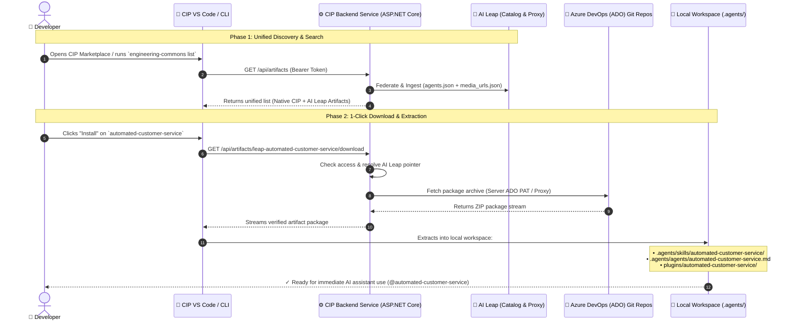

# 🚀 AI Leap Artifact Storage Analysis & Engineering Commons Integration Architecture

> **Document Purpose**: Deep-dive technical analysis of how **AI Leap** stores, catalogs, and serves AI artifacts, and the step-by-step architectural design for integrating AI Leap into **Engineering Commons** for unified search, discovery, and 1-click local installation.

---

## 1. Executive Summary

**AI Leap** (`Ai Leap/MAQ Software AI Leap`) is MAQ Software's enterprise AI solution platform featuring domain-specific AI agents, pipelines, and use cases across Retail, BFSI, Healthcare, and Manufacturing.

**Engineering Commons** is integrating with AI Leap as a federated artifact registry. Developers using the **Engineering Commons VS Code Extension** or **CIP CLI** can browse all AI Leap solutions, click **Install**, and have the AI skills, subagents, and solution code automatically extracted into their local `.agents/` workspace.

---

## 2. Deep Dive: How AI Leap Actually Stores & Serves AI Artifacts

AI Leap uses a **3-tier hybrid storage architecture** rather than a single database table.

```
┌────────────────────────────────────────────────────────────────────────┐
│                        AI LEAP PLATFORM ARCHITECTURE                   │
└────────────────────────────────────────────────────────────────────────┘

  1. METADATA & POINTER TIER (Fast JSON Catalog)
     ├── data/agents.json        ──> Domain Taxonomy & Agent Profiles
     └── media_urls.json         ──> UseCase ID -> Physical Storage Pointer
                                             │
               ┌─────────────────────────────┴─────────────────────────────┐
               ▼                                                           ▼
  2. PHYSICAL STORAGE TIER
     ├── GitHub / ADO Repositories                 ├── SharePoint Document Library
     │   (e.g., MAQ-Retail/Automated-Customer-Service)  │   (AILEAPDocumentLibrary/FastSolutions/*.pptx)
     │   Contains: Code, Prompts, Configs, Skills  │   Contains: Solution Attachments & Decks
     │                                             │
     └─────────────────────────────┬───────────────┴───────────────────────────┘
                                   │
  3. BACKEND PROXY & DELIVERY TIER (Python FastAPI)
     ├── src/api/routes/github_proxy.py        ──> /api/github/download-zip (Server-side PAT)
     ├── src/api/routes/sharepoint_artifact.py ──> /api/sharepoint/artifact-preview/{id} (Graph API)
     └── src/api/routes/solutions.py           ──> /api/solutions/upload (New solution submissions)
```

### Tier 1: Metadata & Pointer Catalog
- **`backend/data/agents.json`**:
  - The "Product Catalog" of AI Leap.
  - Contains full metadata: `id` (e.g., `automated-customer-service`, `monday-morning-agent`), `title`, `description`, `key_features`, `impact_metrics`, `maturity` ("Production"), `architecture` ("Pro Code" / "Low Code"), and `tags`.
- **`backend/media_urls.json`**:
  - The "Pointer Dictionary" that links each `use_case_id` to its physical storage:
  ```json
  "automated-customer-service": {
      "github_repo": "https://github.com/MAQ-Retail/Automated-Customer-Service",
      "video_url": "https://adlsaimlinitiativedev.blob.core.windows.net/...",
      "architecture_image": "/images/automated customer service agent.png"
  },
  "certyfast": {
      "github_repo": "",
      "artifact_deck": {
          "site_path": "sites/MAQSoftwareAllEmployees",
          "library": "AILEAPDocumentLibrary",
          "folder": "FastSolutions",
          "file": "CertyFAST by MAQ Software.pptx"
      }
  }
  ```

### Tier 2: Physical Binary & Code Storage
1. **GitHub / Azure DevOps (ADO) Repositories**:
   - Real working codebases, prompts (`Prompts/SystemPrompt.txt`), skills, and configuration files live in private Git repositories under organizational accounts (e.g., `MAQ-Retail`, `MAQ-BFSI`).
2. **SharePoint Document Library (`AILEAPDocumentLibrary`)**:
   - Slide decks, executive summaries, and solution ZIP archives uploaded via the "Submit Solution" portal are stored in SharePoint document libraries via Microsoft Graph API.
3. **Azure Blob Storage (`adlsaimlinitiativedev.blob.core.windows.net`)**:
   - Houses video demonstrations, architecture diagrams, and static media.

### Tier 3: Proxy & Serving Mechanism
- AI Leap **never exposes private GitHub PATs or SharePoint credentials to browser clients**.
- When a user downloads an artifact, the backend route (`/api/github/download-zip?repo_url=...&ref=main` in `github_proxy.py`) calls the GitHub API (`https://api.github.com/repos/{owner}/{repo}/zipball/{ref}`) using a server-side `GITHUB_PAT` and streams the compressed ZIP file to the user.

---

## 3. How Engineering Commons Integrates With AI Leap

Engineering Commons integrates with AI Leap through a **Unified Catalog Federation & Proxy Pipeline** in `cip-backend-dotnet`.



---

## 4. Technical Integration Steps in Engineering Commons

### Step 1: Catalog Synchronization & Federation (`AiLeapSyncService`)
- In `cip-backend-dotnet`, implement `IAiLeapSyncService`:
  1. Reads `agents.json` and `media_urls.json` from AI Leap (or queries AI Leap's REST endpoints).
  2. Converts each AI Leap record into an CIP `ArtifactDto`:
     ```csharp
     new ArtifactDto
     {
         Id = $"leap-{useCase.Id}",
         Name = useCase.Title,
         Type = useCase.Architecture == "Pro Code" ? "agent" : "solution",
         Version = "1.0.0",
         Description = useCase.Description,
         CipPackage = media.GithubRepo ?? $"sharepoint/{media.ArtifactDeck?.File}",
         Source = "AI_LEAP",
         IsCertified = true,
         CertificationStatus = "CERTIFIED"
     }
     ```
  3. Merges AI Leap artifacts into CIP's `GET /api/artifacts` endpoint.

### Step 2: Download Stream Handler
- In `ArtifactsController.cs`:
  - When `GET /api/artifacts/leap-{id}/download` is called:
    1. If the artifact has a `github_repo`, CIP Backend calls the repo zipball endpoint using the server-side PAT.
    2. If the artifact is a SharePoint deck/solution, CIP Backend retrieves it via Microsoft Graph.
    3. Streams the package to the client with appropriate headers (`application/zip`).

### Step 3: Client-Side Extraction in VS Code Extension & CLI
- The VS Code Extension (`engineeringCommonsSidebarWebviewProvider.ts`) and CLI (`InstallCommand.cs`):
  1. Receives the streamed ZIP.
  2. Identifies whether it contains `.md` agent instructions, Python/C# source code, or skill files.
  3. Automatically unpacks files into the developer's project directory:
     - Skills: `.agents/skills/<name>/SKILL.md`
     - Subagents: `.agents/agents/<name>.md`
     - Plugins: `plugins/<name>/`

### Step 4: Future Solution Uploads
- When new solutions are uploaded to AI Leap via `/api/solutions/upload` or newly committed to `media_urls.json`:
  - CIP's periodic catalog sync automatically detects the new entries.
  - The new solutions immediately appear in the VS Code Marketplace and CLI with **zero code changes required**.

---

## 5. Summary Table: Native CIP vs. AI Leap Storage

| Feature | Native Engineering Commons | AI Leap Platform | Unified Integration Result in CIP |
|---|---|---|---|
| **Catalog Source** | SQLite DB (`cip.db`) | `agents.json` & `media_urls.json` | Federates both into a single unified marketplace API |
| **Code / Artifact Storage** | GitHub / ADO Release Tags | GitHub / ADO Org Repos & SharePoint | CIP Backend resolves whichever storage backend holds the files |
| **Authentication** | Microsoft Entra ID (SSO) | Microsoft Entra ID (MSAL) | Single Sign-On across all corporate @maqsoftware.com accounts |
| **Installation Target** | Local `.agents/` workspace | Web ZIP download | 1-Click install directly into local `.agents/skills/` & `.agents/agents/` |
