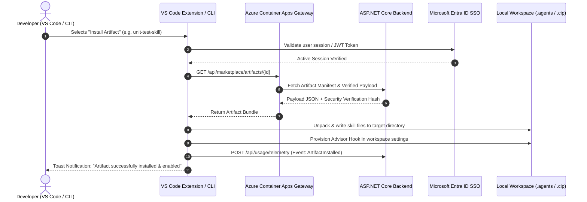
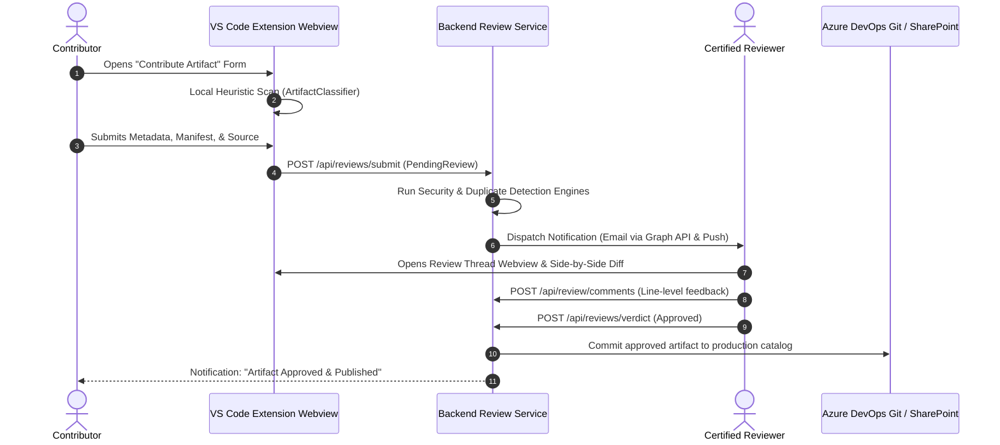

# Engineering Commons — Comprehensive Codebase & Architecture Dictionary

> **Target Audience**: External Code Reviewers, Systems Architects, and Contributing Engineers  
> **Repository Branch**: `Engineering-Commons-Code`  
> **Technologies**: .NET 10 (C#), TypeScript (VS Code Extension), Node.js (Express Gateway), Azure Container Apps, Microsoft Entra ID (SSO), xUnit, Mocha.

---

## 1. Executive Architectural Overview

**Engineering Commons** is an enterprise AI artifacts marketplace, governance platform, and developer enablement ecosystem. It allows engineers to discover, install, update, review, and contribute curated AI engineering artifacts (prompts, agent instructions, custom skills, and CLI tools) across their local IDEs and terminal environments.

The repository is organized into four core functional subsystems:

```
┌────────────────────────────────────────────────────────────────────────┐
│                          DEVELOPER INTERFACES                          │
│                                                                        │
│   ┌────────────────────────────────┐  ┌────────────────────────────┐   │
│   │   VS Code Extension (TypeScript)│  │   Console CLI (C# .NET 10) │   │
│   │   • Tree View & Webview Panels │  │   • Terminal Commands      │   │
│   │   • Inline Code Reviews & Diffs│  │   • Disk Cache & Offline   │   │
│   │   • Auto-Hook Provisioner      │  │   • Git-Style Diff Engine  │   │
│   └───────────────┬────────────────┘  └──────────────┬─────────────┘   │
└───────────────────┼──────────────────────────────────┼─────────────────┘
                    │                                  │
                    ▼                                  ▼
┌────────────────────────────────────────────────────────────────────────┐
│                        API GATEWAY & BACKEND                           │
│                                                                        │
│   ┌────────────────────────────────────────────────────────────────┐   │
│   │  Azure Container Apps Gateway (`api/` Node.js Express Runtime) │   │
│   │  • High-performance gzip response compression                  │   │
│   │  • Live Catalog search & reverse proxy to enterprise services  │   │
│   └───────────────────────────────┬────────────────────────────────┘   │
│                                   │                                    │
│   ┌───────────────────────────────▼────────────────────────────────┐   │
│   │  Enterprise REST Backend (`cip-backend-dotnet/` ASP.NET Core)  │   │
│   │  • RBAC & Microsoft Entra ID (SSO) Authentication              │   │
│   │  • Artifact Governance, Multi-Stage Reviews & Approvals        │   │
│   │  • Reviewer Certification Scoring & Qualification Engine       │   │
│   │  • Automated Telemetry Aggregation & Bounty Gamification       │   │
│   └────────────────────────────────────────────────────────────────┘   │
└────────────────────────────────────────────────────────────────────────┘
```

---

## 2. End-to-End System Flows

### Flow 1: Artifact Installation & Hook Provisioning Flow



---

### Flow 2: Artifact Contribution & Multi-Stage Review Lifecycle



---

## 3. Comprehensive File-by-File Dictionary

### 3.1. Repository Root & DevOps Infrastructure

| File Path | Functional Responsibility |
| :--- | :--- |
| `Dockerfile` | Defines the production container image for the Node.js Express Gateway hosted on Azure Container Apps. Uses Alpine Linux (`node:20-alpine`) for a minimal footprint and fast startup. |
| `.dockerignore` | Prevents unnecessary files (`node_modules`, `bin/`, `obj/`, `.git`) from being copied into the container build context. |
| `.gitignore` | Standard exclusion list preventing compiler outputs, IDE caches, and temporary test artifacts from entering version control. |
| `package.json` | Manifest for the containerized API Gateway (`cip-api-gateway`). Declares runtime dependencies `express` and `cors` for the Azure Container App service. |
| `package-lock.json` | Deterministic dependency tree lockfile ensuring repeatable container builds. |
| `README.md` | General overview of Engineering Commons, setup steps, architectural layers, and links to component documentation. |
| `SYSTEM-ARCHITECTURE.md` | Deep architectural document detailing subsystem interaction, data contracts, and security compliance. |
| `.github/workflows/cip-backend-AutoDeployTrigger-*.yml` | GitHub Actions CI/CD deployment pipeline triggering container builds and pushes to Azure Container Registry (`ca45c2f88c77acr.azurecr.io`) upon push. |
| `.vscode/launch.json` | Multi-target debugger configuration enabling one-click F5 launching of the .NET Web API, CLI console app, and the VS Code Extension Host. |
| `.vscode/tasks.json` | Build tasks for compiling TypeScript (`npm compile`) and building .NET projects (`dotnet build`). |
| `.vscode/settings.json` | Editor workspace settings enforcing consistent indentation, encoding, and linting rules. |

---

### 3.2. Container API Gateway (`api/`)

| File Path | Functional Responsibility |
| :--- | :--- |
| `api/index.js` | Production Express HTTP server. Implements gzip response compression (reducing JSON payload sizes by up to 90%), enterprise security headers (`nosniff`, `DENY`), health probes for Azure Container Apps, and REST endpoints for live catalog search, access governance, and usage telemetry ingestion. |
| `api/certificationEngine.js` | Lightweight verification engine calculating qualification criteria and review standards required for automated reviewer certification. |

---

### 3.3. Enterprise Backend Service (`cip-backend-dotnet/`)

#### Controllers (`cip-backend-dotnet/Controllers/`)

| Controller File | Route Prefix | Functional Responsibility |
| :--- | :--- | :--- |
| `AccessGovernanceController.cs` | `/api/access` | Handles access requests for restricted artifacts, role permissions, approval queuing, and permission revocations. |
| `ArtifactClassifierController.cs` | `/api/classify` | Accepts candidate files and metadata, running heuristic and regex analysis to classify artifacts by kind (`Skill`, `Prompt`, `Agent`, `Hook`). |
| `ArtifactDiffController.cs` | `/api/diff` | Computes file-level and line-level diffs between artifact revisions for the review UI. |
| `ArtifactDiscoveryController.cs` | `/api/discover` | Inspects connected repositories and paths to identify uncataloged artifacts available for contribution. |
| `ArtifactPlacementController.cs` | `/api/placement` | Determines the correct workspace installation destination (e.g., `.agents/`, `.gemini/skills/`, `.cip/`). |
| `AuthController.cs` | `/api/auth` | Validates Microsoft Entra ID SSO tokens and local credentials; generates and signs enterprise JWT tokens. |
| `BountyController.cs` | `/api/bounty` | Manages gamified engineering challenges, reward points, contributor claiming, and bounty submissions. |
| `CertificationController.cs` | `/api/certification`| Handles reviewer certification applications, evaluates reviewer performance scorecards, and manages administrator sign-offs. |
| `DiagnosticsController.cs` | `/api/diagnostics` | System health check endpoint inspecting uptime, database/SharePoint reachability, and memory consumption. |
| `MarketplaceController.cs` | `/api/marketplace` | Core marketplace CRUD controller providing artifact listings, full-text search, category filtering, and version history retrieval. |
| `NotificationController.cs` | `/api/notifications`| Provides notification streaming and polling for reviews, access requests, and system announcements. |
| `ReviewCommentsController.cs` | `/api/review/comments`| Manages line-specific reviewer comments, feedback threads, and resolutions during code review. |
| `ReviewsController.cs` | `/api/reviews` | Governs the review submission lifecycle: submitting artifacts, advancing review states, recording verdicts, and signing off releases. |
| `ReviewThreadsController.cs` | `/api/review/threads` | Organizes comments into structured, threaded conversations for discussion between authors and reviewers. |
| `UsageController.cs` | `/api/usage` | Ingests telemetry logs from extensions and CLI instances to record artifact installs, invocations, and error events. |
| `UserRoleController.cs` | `/api/roles` | Provides role-based access control (RBAC) querying and assignment for Admins, Reviewers, Contributors, and Users. |

#### Services & Interfaces (`cip-backend-dotnet/Services/`)

| Service File | Interface File | Functional Responsibility |
| :--- | :--- | :--- |
| `AccessGovernanceService.cs` | `IAccessGovernanceService.cs` | Enforces authorization checks and approval workflows for private/restricted artifacts. |
| `ArtifactClassifier.cs` | `IArtifactClassifier.cs` | Analyzes code structure, frontmatter, and AST indicators to categorize submitted artifacts. |
| `ArtifactDiffService.cs` | `IArtifactDiffService.cs` | Generates unified git-style diffs highlighting insertions, deletions, and modifications. |
| `ArtifactDiscoveryService.cs` | `IArtifactDiscoveryService.cs` | Traverses repository directory structures to locate valid artifact manifests. |
| `ArtifactPlacementService.cs` | `IArtifactPlacementService.cs` | Resolves host-specific configuration files and target paths for artifact execution. |
| `AuthenticationService.cs` | `IAuthenticationService.cs` | Implements authentication logic, claims validation, and password hash verifications. |
| `BountyService.cs` | `IBountyService.cs` | Tracks bounty rewards, claims, deadlines, and completion validation. |
| `CertificationService.cs` | `ICertificationService.cs` | Calculates reviewer track records, accuracy rates, and certification eligibility scores. |
| `EmailNotificationService.cs` | `IEmailNotificationService.cs` | Composes and dispatches HTML notification emails for workflow events. |
| `MarketplaceService.cs` | `IMarketplaceService.cs` | Orchestrates queries across the artifact catalog, indexing tags, and version hierarchies. |
| `MicrosoftGraphEmailClient.cs` | `IMicrosoftGraphEmailClient.cs` | Direct HTTP client integrating with Microsoft Graph API using OAuth client credentials to send emails. |
| `NotificationService.cs` | `INotificationService.cs` | Centralized notification distributor managing in-app notifications and unread badges. |
| `ReviewCommentService.cs` | `IReviewCommentService.cs` | Persists and retrieves comments linked to specific lines or files in an artifact package. |
| `ReviewRepository.cs` | `IReviewRepository.cs` | Repository abstraction isolating review data storage operations from business logic. |
| `ReviewService.cs` | `IReviewService.cs` | Implements business rules for artifact review transitions (Draft -> UnderReview -> Approved -> Rejected). |
| `ReviewThreadService.cs` | `IReviewThreadService.cs` | Manages lifecycle of threaded discussion groups on review items. |
| `TokenService.cs` | `ITokenService.cs` | Handles symmetric/asymmetric JWT token generation, encryption, signing, and claim extraction. |
| `UsageService.cs` | `IUsageService.cs` | Processes telemetry batches, aggregates monthly usage metrics, and detects anomalous activity. |
| `UserRoleService.cs` | `IUserRoleService.cs` | Evaluates user permissions, team memberships, and administrator role grants. |

#### Models (`cip-backend-dotnet/Models/`)

| Model File | Functional Responsibility |
| :--- | :--- |
| `AccessGovernanceModels.cs` | DTOs for access requests, approval states, and permission grant records. |
| `ArtifactClassifierModels.cs` | Data contracts for classifier inputs, detected types, confidence scores, and safety flags. |
| `ArtifactDiffModels.cs` | Data structures representing file diffs, hunk lines, and status indicators (`Added`, `Modified`, `Deleted`). |
| `ArtifactDiscoveryModels.cs` | Data contracts capturing discovered artifact candidates and metadata. |
| `ArtifactPlacementModels.cs` | Configuration models mapping artifact dependencies to host IDE directories. |
| `AuthModels.cs` | Login requests, Microsoft SSO tokens, authentication responses, and user profile claims. |
| `BountyModels.cs` | Bounty definitions, point values, submission links, and status enums. |
| `CertificationModels.cs` | Certification levels (Junior, Senior, Lead Reviewer), qualifications, and scorecard records. |
| `DiagnosticsModels.cs` | Health diagnostics DTOs reporting memory, GC status, and external dependency connectivity. |
| `MarketplaceModels.cs` | Primary entity models for artifacts, release versions, tags, categories, and author metadata. |
| `NotificationModels.cs` | Notification payloads, types (`ReviewPending`, `Approved`, `AccessGranted`), and timestamps. |
| `ReviewCommentModels.cs` | Data structures for line numbers, comment text, author details, and resolution timestamps. |
| `ReviewModels.cs` | Review requests, submission envelopes, approval checklists, and reviewer signatures. |
| `ReviewThreadModels.cs` | Aggregated thread models grouping parent comments and nested replies. |
| `UsageModels.cs` | Telemetry event payloads capturing user identity, artifact ID, client version, and action taken. |
| `UserRoleModels.cs` | Role definitions, permission bitmasks, and team assignment records. |

#### Program & Settings

| File Path | Functional Responsibility |
| :--- | :--- |
| `Program.cs` | Application bootstrapper. Configures ASP.NET Core dependency injection, registers controllers, sets up CORS policies, configures JWT authentication, and maps endpoint routes. |
| `appsettings.json` | Production configuration holding backend endpoints, Azure Entra ID client IDs, and log levels. |
| `appsettings.Development.json` | Local developer configuration overrides. |
| `cip-backend-dotnet.csproj` | MSBuild project file targeting .NET 10 with ASP.NET Core framework references. |

---

### 3.4. Backend Test Suite (`cip-backend-dotnet.Tests/`)

| Test File | Verification Scope |
| :--- | :--- |
| `AccessGovernanceTests.cs` | Verifies request access submission, approval by authorized reviewers, rejection, and revocation. |
| `ArtifactClassifierTests.cs` | Validates regex and heuristic classification logic against valid/invalid artifact samples. |
| `ArtifactDiffServiceTests.cs` | Verifies unified diff computation, modified line highlighting, and edge cases in binary files. |
| `AuthenticationTests.cs` | Tests user credential verification, password hashing, and token signature validation. |
| `AzureDevOpsMarketplaceServiceTests.cs` | Tests synchronization of artifacts to and from Azure DevOps Git repositories. |
| `BountyServiceTests.cs` | Tests bounty lifecycle from open -> claimed -> submitted -> verified -> awarded. |
| `CertificationTests.cs` | Validates scoring algorithms to ensure only reviewers meeting qualification thresholds pass. |
| `DuplicateDetectionTests.cs` | Ensures that submitting duplicate or near-identical artifacts triggers conflict detection. |
| `EmailDiagnosticsTests.cs` | Validates email template generation, recipient formatting, and delivery error handling. |
| `GitHubMarketplaceServiceTests.cs` | Tests interaction with GitHub repos for artifact synchronization. |
| `ManualVerificationTests.cs` | Tests manual administrator verification workflows and overrides. |
| `MarketplaceVersionTests.cs` | Tests SemVer semantic version parsing, version bumps, and historical rollback. |
| `MicrosoftGraphEmailTests.cs` | Verifies Graph API JSON payloads, header authorization, and retry logic. |
| `NotificationTests.cs` | Tests notification delivery queues, unread counters, and recipient filtering. |
| `ReviewCommentTests.cs` | Verifies inline comment creation, replies, and marking comments as resolved. |
| `ReviewThreadTests.cs` | Validates grouping and chronological sorting of review conversation threads. |
| `UsageTelemetryTests.cs` | Verifies batch ingestion of telemetry data and aggregation calculations. |
| `cip-backend-dotnet.Tests.csproj` | xUnit test project file with test SDK and Moq dependencies targeting .NET 10. |

---

### 3.5. Console CLI Application (`EngineeringCommonsCli/`)

#### Commands (`EngineeringCommonsCli/Commands/`)

| Command File | Invocation | Functional Responsibility |
| :--- | :--- | :--- |
| `AccessCommand.cs` | `engineering-commons access` | Submits access requests for gated artifacts and displays user permission status in the terminal. |
| `BountyCommand.cs` | `engineering-commons bounty` | Lists open bounty challenges, allows developers to claim a bounty, and submits solutions. |
| `CertificationCommand.cs`| `engineering-commons certify` | Initiates the reviewer certification workflow and displays user scorecard metrics. |
| `ContributeCommand.cs` | `engineering-commons contribute` | Packages a local artifact directory, validates frontmatter, and submits it for peer review. |
| `InstallCommand.cs` | `engineering-commons install` | Downloads an artifact from the marketplace, unpacks files to the workspace, and registers hooks. |
| `ListCommand.cs` | `engineering-commons list` | Displays a formatted terminal table of available artifacts with category and rating filters. |
| `ListVersionsCommand.cs` | `engineering-commons versions` | Lists version history and release notes for a specified artifact. |
| `LoginCommand.cs` | `engineering-commons login` | Launches the browser for Microsoft Entra SSO login and securely stores the authentication session. |
| `RecommendCommand.cs` | `engineering-commons recommend`| Inspects local project files and suggests relevant AI artifacts tailored to the tech stack. |
| `ReviewCommand.cs` | `engineering-commons review` | Enables certified reviewers to view pending review submissions and issue approvals or rejections from the terminal. |
| `StatusCommand.cs` | `engineering-commons status` | Displays the current user session, backend URL, and installed artifact health. |
| `UpdateCommand.cs` | `engineering-commons update` | Checks for updates to installed artifacts and applies non-breaking revisions. |
| `UseCommand.cs` | `engineering-commons use` | Executes or loads an installed artifact in the current terminal context. |
| `VisibilityCommand.cs` | `engineering-commons visibility`| Changes an artifact's access visibility (`Public`, `Internal`, `Private`). |

#### Services & Interfaces (`EngineeringCommonsCli/Services/`)

| Service File | Interface File | Functional Responsibility |
| :--- | :--- | :--- |
| `ArtifactClassifier.cs` | `IArtifactClassifier.cs` | Performs local file analysis before contribution to ensure compliance with standards. |
| `ArtifactDiscoveryService.cs` | `IArtifactDiscoveryService.cs` | Scans workspace trees to identify candidate prompt and skill files. |
| `ArtifactMetadataService.cs` | `IArtifactMetadataService.cs` | Extracts and parses YAML frontmatter and JSON configurations from artifact files. |
| `ArtifactPlacementService.cs` | `IArtifactPlacementService.cs` | Determines installation targets (`.agents/`, `.gemini/skills/`, `.cip/`). |
| `AuthenticationService.cs` | `IAuthenticationService.cs` | Handles interactive user credentials and session initialization. |
| `MicrosoftSsoAuthService.cs` | `ISsoAuthService.cs` | Performs Microsoft Entra ID OAuth 2.0 PKCE browser authentication. |
| `BackendClient.cs` | `IBackendClient.cs` | Typed HTTP client communicating with the Azure Container Apps backend. |
| `CipService.cs` | `ICipService.cs` | Central business orchestrator coordinating CLI operations across services. |
| `CliDiskCache.cs` | `ICliDiskCache.cs` | Manages local disk caching of catalog metadata for fast offline access. |
| `FileAuthTokenStore.cs` | `IAuthTokenStore.cs` | Securely stores authentication tokens in the user's local profile directory. |
| `SharePointGraphClient.cs` | `ISharePointGraphClient.cs` | Fallback client providing direct communication with SharePoint lists if needed. |
| `UnifiedDiffRenderer.cs` | `IUnifiedDiffRenderer.cs` | Formats and colorizes unified git diffs directly in the terminal output. |
| `WorkspaceContextExtractor.cs`| `IWorkspaceContextExtractor.cs`| Analyzes project file extensions (`.cs`, `.ts`, `.py`) to identify active technology stacks. |

#### Models & Entry Point

| File Path | Functional Responsibility |
| :--- | :--- |
| `Program.cs` | CLI entry point utilizing `System.CommandLine` to define arguments, options, and route commands. |
| `README.md` | Usage documentation, command reference, and CLI installation instructions. |
| `Models/AccessRequestCliDto.cs` | Data transfer objects for access command operations. |
| `Models/ArtifactClassificationModels.cs`| Models representing classification results and security checks. |
| `Models/ArtifactSubmission.cs` | Payload structures for submitting new artifacts. |
| `Models/BountyCliModels.cs` | Data models representing bounty challenges and submission data. |
| `Models/CertificationModels.cs` | DTOs representing reviewer certification status. |
| `Models/RecommendationModels.cs` | Models for contextual artifact recommendations. |
| `Models/ReviewModels.cs` | Models representing review queues, diffs, and verdicts. |
| `Models/UserSession.cs` | Encapsulates active user identity, token expiration, and role claims. |
| `EngineeringCommonsCli.csproj` | .NET 10 console application project configuration. |

---

### 3.6. CLI Test Suite (`EngineeringCommonsCli.Tests/`)

| Test File | Verification Scope |
| :--- | :--- |
| `AccessCommandTests.cs` | Verifies `access request` and `access status` CLI argument parsing and error reporting. |
| `ArtifactClassifierTests.cs` | Validates classification accuracy across diverse file structures. |
| `ArtifactPlacementTests.cs` | Ensures that artifacts are copied to appropriate paths without overwriting user files. |
| `BountyCommandTests.cs` | Tests listing, claiming, and submitting bounties via the CLI. |
| `CliDiskCacheTests.cs` | Tests cache expiration, eviction, and serialization to disk. |
| `InstallCommandTests.cs` | Validates end-to-end installation command behavior and failure rollbacks. |
| `InstallVersionTests.cs` | Tests installing specific pinned versions of an artifact. |
| `ListCommandTests.cs` | Tests terminal output rendering and category filter flags. |
| `ListVersionsCommandTests.cs` | Verifies version history output formatting. |
| `LoginCommandTests.cs` | Tests interactive login flows and token storage. |
| `ReviewCommandTests.cs` | Tests CLI-based review approval and rejection commands. |
| `SecurityDiscoveryTests.cs` | Validates that sensitive files (e.g. `.env`, private keys) are rejected during contribution. |
| `SsoLoginCommandTests.cs` | Tests Microsoft Entra ID SSO browser launch and token exchange. |
| `StatusCommandTests.cs` | Verifies status display output under authenticated and unauthenticated states. |
| `UnifiedDiffRendererTests.cs` | Tests colorized diff rendering on multi-line additions and deletions. |
| `VisibilityCommandTests.cs` | Tests changing artifact visibility via the CLI. |
| `EngineeringCommonsCli.Tests.csproj` | xUnit project file targeting .NET 10 for CLI tests. |

---

### 3.7. VS Code Extension (`engineering-commons-vscode/`)

#### Core Extension & Configuration

| File Path | Functional Responsibility |
| :--- | :--- |
| `src/extension.ts` | Extension activation entry point (`activate`). Registers all commands, initializes tree data providers, registers webview view providers, sets up status bar items, and starts the background notification poller. |
| `package.json` | VS Code extension manifest defining commands, settings, view containers, icons, activation events, and extension dependencies. |
| `package-lock.json` | Locked dependency tree for extension build and test tools. |
| `tsconfig.json` | TypeScript compiler configuration targeting ES2022 with Node module resolution. |
| `.vscodeignore` | Packaging exclusion file ensuring source files and tests are excluded from the distributed `.vsix`. |
| `README.md` | User-facing guide explaining features, configuration settings, and keyboard shortcuts. |
| `resources/icon.svg` | Vector branding icon displayed in the VS Code Activity Bar. |
| `resources/catalog/masterCatalog.json`| Fallback artifact catalog bundled with the extension for offline functionality. |

#### Extension Commands (`engineering-commons-vscode/src/commands/`)

| Command File | Registered Command ID | Functional Responsibility |
| :--- | :--- | :--- |
| `contributeCommand.ts` | `engineeringCommons.contribute` | Opens the interactive contribution webview to author and publish a new artifact. |
| `installCommand.ts` | `engineeringCommons.install` | Initiates the download, unpacking, and workspace registration of a selected artifact. |
| `listCommand.ts` | `engineeringCommons.list` | Triggers a search or refresh of the artifact explorer tree view. |
| `loginCommand.ts` | `engineeringCommons.login` / `loginSso` | Triggers Microsoft Entra SSO or credential login to authenticate the developer. |
| `reviewCommand.ts` | `engineeringCommons.review` | Opens the review portal webview for reviewing submitted artifacts. |
| `updateCommand.ts` | `engineeringCommons.update` | Checks for new versions of installed artifacts and performs an in-place upgrade. |
| `visibilityCommand.ts` | `engineeringCommons.visibility` | Prompts the user to change an artifact's visibility level. |

#### Extension Services (`engineering-commons-vscode/src/services/`)

| Service File | Functional Responsibility |
| :--- | :--- |
| `adoGovernanceService.ts` | Interacts with Azure DevOps Git repositories to query branches and commit artifact files. |
| `adoTelemetryService.ts` | Emits anonymous usage telemetry pings to Azure DevOps reporting dashboards. |
| `advisorHookProvisioner.ts` | Injects Copilot advisor hooks and instruction references into `.vscode/settings.json`. |
| `artifactRegistry.ts` | Manages local storage of installed artifact manifests in global extension state. |
| `artifactUsageCollector.ts` | Monitors when artifacts are invoked to track developer productivity metrics. |
| `authenticationStatusProvider.ts` | Exposes current authentication state to UI components and the status bar. |
| `backendUsageClient.ts` | Transmits batched usage telemetry events to the Azure Container Apps backend. |
| `bountyService.ts` | Queries and retrieves active bounty opportunities for the sidebar. |
| `certificationService.ts` | Queries reviewer qualification status and submits reviewer certification requests. |
| `cliExecutor.ts` | Executes installed CLI commands via Node child processes when terminal execution is required. |
| `cliProvisioner.ts` | Detects whether the CLI binary exists in PATH; assists with automatic downloading if missing. |
| `installationChecker.ts` | Scans the workspace to verify if a given artifact is already installed and up to date. |
| `notificationClient.ts` | Low-level HTTP client polling the backend notification endpoint. |
| `notificationCoordinator.ts`| Coordinates notification delivery, displays toasts, and manages the sidebar badge counter. |
| `notificationService.ts` | Manages in-memory notification caches and marks notifications as read/deleted. |
| `reviewCommentService.ts` | Provides API integration for creating and retrieving line-specific review comments. |
| `reviewContentProvider.ts` | Custom `TextDocumentContentProvider` serving virtual diff content (`engineering-commons://`) for side-by-side diffing. |
| `reviewThreadService.ts` | Coordinates multi-comment threads during artifact peer reviews. |
| `ssoService.ts` | Handles Microsoft Entra ID OAuth 2.0 PKCE authentication flow within the VS Code environment. |
| `usageLogger.ts` | Local file-based fallback logger for session activity. |
| `usageTracker.ts` | High-level tracker capturing extension interaction events. |
| `zipArchiveService.ts` | Unpacks `.zip` bundles when artifacts are delivered as compressed archives. |
| `sharepoint/sharepointClient.ts` | Low-level SharePoint Graph API client for enterprise list communication. |
| `sharepoint/sharepointArtifactService.ts` | SharePoint-backed artifact catalog synchronization. |
| `sharepoint/sharepointBountyService.ts` | SharePoint list integration for bounty tracking. |
| `sharepoint/sharepointReviewService.ts` | SharePoint list integration for review workflows. |
| `sharepoint/sharepointTelemetryService.ts`| SharePoint list integration for telemetry logging. |
| `sharepoint/telemetryBatcher.ts` | Batches telemetry events before dispatching to prevent network bottlenecks. |

#### Webviews & UI Providers (`engineering-commons-vscode/src/views/`)

| Provider File | UI Type | Functional Responsibility |
| :--- | :--- | :--- |
| `artifactTreeDataProvider.ts` | Tree View Provider | Implements the primary sidebar tree view in the Activity Bar, organizing artifacts into categories (Installed, Recommended, Trending, Review Queue). |
| `artifactDetailsWebviewProvider.ts` | Webview Provider | Renders an HTML view showing full artifact details, README, version history, author badges, and an "Install" action button. |
| `contributeWebviewProvider.ts` | Webview Provider | Renders an authoring wizard where developers can write or paste artifact definitions and test them prior to submission. |
| `engineeringCommonsSidebarWebviewProvider.ts` | Webview Provider | Secondary webview panel hosting real-time search, filters, and tag selection. |
| `threadWebviewProvider.ts` | Webview Provider | Displays threaded discussions and line-by-line review comments in an interactive chat-style UI. |
| `usageDashboardWebviewProvider.ts` | Webview Provider | Renders visual analytics charts showing personal and team artifact utilization over time. |

#### Models (`engineering-commons-vscode/src/models/`)

| Model File | Functional Responsibility |
| :--- | :--- |
| `usageEvent.ts` | TypeScript interface defining telemetry schema: user ID, artifact ID, event action, timestamp, and duration. |

#### VS Code Extension Test Suite (`engineering-commons-vscode/test/`)

| Test File | Verification Scope |
| :--- | :--- |
| `advisorHookProvisioner.test.ts` | Tests workspace settings modification and hook injection. |
| `agentUsageTracking.test.ts` | Tests telemetry event recording and batch dispatching. |
| `artifactDetails.test.ts` | Tests HTML generation and message passing in the Artifact Details webview. |
| `backendUrlSync.test.ts` | Verifies that backend URL configuration updates correctly synchronize across services. |
| `bountySidebar.test.ts` | Tests rendering and interaction logic in the bounty view. |
| `certification.test.ts` | Tests reviewer certification UI interactions and status rendering. |
| `contributeWebview.test.ts` | Validates contribution form validation, field sanitization, and submission handling. |
| `extension.test.ts` | Tests extension activation and command registration sanity. |
| `githubDiffReview.test.ts` | Tests virtual diff document generation and side-by-side comparison. |
| `installationChecker.test.ts` | Verifies detection of installed artifacts in local project folders. |
| `mocks.ts` | Common mocks for VS Code window, workspace, and configuration APIs. |
| `notification.test.ts` | Tests notification polling, badge counter updates, and dismiss actions. |
| `reviewComment.test.ts` | Tests creating, replying to, and deleting review comments. |
| `setup.ts` | Global test setup and environment initialization for Mocha. |
| `visibilityCommand.test.ts` | Tests changing artifact visibility via extension commands. |
| `vscode-mock.ts` | Complete mock implementation of the `vscode` module for standalone unit testing outside the IDE. |
| `zipDownload.test.ts` | Tests archive downloading and extraction routines. |

---

## 4. Verification and Build Instructions

To verify any component of the repository, execute the corresponding build command from the repository root:

```bash
# 1. Build and Run Tests for ASP.NET Core Backend
dotnet test cip-backend-dotnet.Tests/cip-backend-dotnet.Tests.csproj

# 2. Build and Run Tests for Console CLI
dotnet test EngineeringCommonsCli.Tests/EngineeringCommonsCli.Tests.csproj

# 3. Compile and Test VS Code Extension
cd engineering-commons-vscode
npm install
npm run compile
npm test
```
