# Engineering Commons — Master Code Review Presentation & Technical Defense Guide

> **Document Type**: Comprehensive Spoken Presentation Script, Exhaustive File-by-File Dictionary, and 25-Question Technical Defense Guide  
> **Target Audience**: External Code Reviewers, Principal Architects, and Engineering Leadership  
> **Target Branch**: Azure DevOps (`Engineering-Commons-Code`)  
> **Presenter Instructions**: You can read Part 1 directly aloud word-for-word during your code review session. Part 2 contains folder-by-folder and file-by-file single-line descriptions. Part 3 provides complete model answers for all 25 technical review questions.

---

# PART 1: SPOKEN PRESENTATION SCRIPT
*(Read this section directly out loud to introduce the project, technology stack, and architecture.)*

"Good morning, everyone, and thank you for taking the time to review the **Engineering Commons** codebase today.

### What is Engineering Commons & What Have We Built?
Across modern software organizations, engineers are creating high-value AI assets every single day—prompt templates, autonomous agent definitions, custom skills, and Copilot instructions. However, these assets are typically fragmented across local machines, lost in chat histories, or buried in private branches. There is no central marketplace, no standardized review process, no quality certification, and zero visibility into who is adopting which tool.

That is why we built **Engineering Commons**. 

Engineering Commons is an enterprise-grade AI artifact marketplace, governance engine, and developer enablement platform. We have delivered:
1. **A central artifact repository** with semantic versioning and role-based access control (RBAC).
2. **A gamified bounty system** where teams post bounties for needed skills, and developers claim them, submit solutions, earn credits, and build reputations.
3. **A multi-tier governance and certification pipeline** featuring automated code-diff generation, line-by-line review comments, and automated quality scoring.
4. **Frictionless developer touchpoints**: Developers interact via a rich **VS Code Extension** with side-by-side diff viewers, and through a cross-platform **Console CLI** for terminal workflows.
5. **Zero-effort AI discovery**: When an artifact is installed, our background provisioner automatically configures GitHub Copilot workspace instructions in `.github/copilot-instructions.md`, making the installed tools immediately discoverable by AI assistants in the IDE with zero network round-trips.

---

### Technology Stack & Why Specific Languages Were Chosen

We deliberately designed Engineering Commons as a multi-tier platform with distinct responsibilities:

1. **C# and ASP.NET Core (.NET 10) for the Enterprise Backend (`cip-backend-dotnet`)**:
   - *Why?* The backend handles mission-critical operations—role-based access control, qualification scoring, review workflows, and cryptographic authentication. C#'s strong static typing, pattern matching, and nullable reference types eliminate null-pointer and type-coercion bugs. .NET 10 delivers industry-leading throughput, low memory allocations, and native Ahead-Of-Time (AOT) readiness.
2. **C# (.NET 10) for the Cross-Platform Console CLI (`EngineeringCommonsCli`)**:
   - *Why?* By sharing .NET 10 across backend and CLI, we share architectural paradigms and data transfer models. The CLI compiles into a single executable binary that runs natively on Windows, macOS, and Linux with millisecond response times.
3. **TypeScript and Node.js for the VS Code Extension (`engineering-commons-vscode`)**:
   - *Why?* The VS Code Extension API is built natively for TypeScript. Strict TypeScript (`strict: true`) guarantees end-to-end type safety across message-passing boundaries between Extension hosts and Webview panels, while Node's asynchronous event loop manages file watchers and background telemetry without blocking the editor UI.
4. **Node.js with Express for the Azure Container Apps Gateway (`api/`)**:
   - *Why?* The gateway acts as an API aggregator and reverse proxy. Node's non-blocking I/O handles high-concurrency requests, live catalog search, and gzip compression with minimal memory overhead, booting in sub-second times inside containerized environments.
5. **SQLite & Entity Framework Core for Persistence**:
   - *Why?* Embedded relational storage requires zero external database infrastructure during local testing and development, while offering a seamless transition to Azure SQL Database.

---

### End-to-End Real Architectural Blueprint (5-Tier Enterprise Architecture)

"Now, please look at the **Architectural Blueprint**. Our production platform is structured across **5 interconnected tiers** designed for high throughput, zero egress overhead, and seamless AI agent invocation:

> 🔗 **Direct File Link**: [Open Full-Resolution Architecture Blueprint (PNG)](file:///c:/Users/HarshPratapSinghRana/Downloads/CIP-Engineering%20Commons/engineering-commons-architecture.png)

```mermaid
%%{init: {'theme': 'neutral', 'themeVariables': { 'background': '#FFFFFF', 'mainBkg': '#FFFFFF', 'primaryTextColor': '#0F172A', 'lineColor': '#334155' }}}%%
flowchart LR
    subgraph T1["1. USER & CLIENT LAYER"]
        direction TB
        DEV["👤 Enterprise Developer\n(Install / Review / Run)"]
        VSC["💻 VS Code Extension\n(company-apm-vscode v1.2.8)"]
        CLI["⌨️ Company APM CLI\n(CompanyApmCli .NET 10)"]
        WS["📁 Local Workspace\n(.agents/skills | .github/agents)"]
        DEV -->|"1. Action"| VSC
        DEV -->|"1. Command"| CLI
    end

    subgraph T2["2. IDENTITY & INGRESS"]
        direction TB
        AAD["🔐 Microsoft Entra ID\n(Azure AD SSO @maqsoftware.com)"]
        RBAC["🛡️ Role-Based Access (RBAC)\n(ADMIN / REVIEWER / PRODUCER / CONSUMER)"]
        ING["🌐 Azure Ingress Gateway\n(443 HTTPS -> 5000 Target)"]
        AAD --> RBAC
        RBAC --> ING
    end

    subgraph T3["3. BACKEND CORE SERVICES (Azure)"]
        direction TB
        ACA["📦 Azure Container App\n(apm-backend Node 20 Alpine)"]
        subgraph FEAT["★ CORE PLATFORM FEATURES"]
            direction TB
            CACHE["⚡ In-Memory Catalog Cache\n(cachedArtifactsMaster 0.1ms)"]
            CERT["🛡️ 5-Pillar Cert Engine\n(Dynamic Health Score >= 85%)"]
            REV["⏱️ Peer Review & Bounties\n(Diff Viewer | 24h/48h SLAs)"]
            NOTIF["🔔 In-App Notifications\n(Review Mentions & Alerts)"]
        end
        ACA --> FEAT
    end

    subgraph T4["4. ZERO-COST STORAGE TIER"]
        direction TB
        ADO["☁️ Azure DevOps Git Repos\n(Master Versions & Source Archives)"]
        SPO["📂 SharePoint Online (M365)\n(Artifacts | Reviews | Bounties)"]
        LEAP["🚀 AI Leap Platform Store\n(Shared Skills, Prompts & Specs)"]
    end

    subgraph T5["5. AI INVOCATION & WORKSPACE"]
        direction TB
        COP["🤖 GitHub Copilot Chat\n(@agent-name Native Invocation)"]
        SLASH["⌨️ Copilot Slash Commands\n(/skill-name Invocation)"]
        AGY["🪐 Antigravity AI Agent IDE\n(Autonomous Subagent Execution)"]
    end

    VSC -->|"2. SSO Token"| AAD
    CLI -->|"2. Device Code"| AAD
    ING -->|"3. HTTPS"| ACA
    FEAT -->|"4. Version Archives"| ADO
    FEAT -->|"5. Business Metadata"| SPO
    FEAT -->|"5. Playbook Specs"| LEAP
    ADO -->|"6. Direct Git Sync"| WS
    WS -->|"7. Agent Spec"| COP
    WS -->|"7. Skill YAML"| SLASH
    WS -->|"8. Autonomous Run"| AGY
    WS -.->|"9. Telemetry Feedback"| FEAT
```

#### Step-by-Step Architecture Explanation (Read Directly):

"Let me explain the exact journey of a request across these 5 tiers:

1. **Tier 1 — User & Client Layer**: 
   The enterprise developer interacts through either the **VS Code Extension (`company-apm-vscode v1.2.8`)** or the cross-platform **Company APM CLI (.NET 10)**. Whether browsing bounties, running a diff review, or installing an artifact, all operations originate here.

2. **Tier 2 — Identity & Ingress**: 
   Before any request touches core infrastructure, identity is verified against **Microsoft Entra ID (Azure AD SSO)**. Our **RBAC Policy Engine** enforces strict role separation across `ADMIN`, `REVIEWER`, `PRODUCER`, and `CONSUMER`. Authenticated traffic enters through the **Azure Ingress Gateway** over HTTPS on port 443, routing directly to the container target.

3. **Tier 3 — Backend Core Services (Azure Container Apps)**: 
   The core application runs inside a serverless **Azure Container App (`apm-backend` on Node 20 Alpine)**. It houses four critical platform subsystems:
   - **In-Memory Catalog Cache (`cachedArtifactsMaster`)**: Delivers sub-millisecond (0.1ms) catalog queries and gzip-compressed responses.
   - **5-Pillar Certification Engine**: Evaluates artifacts across adoption, peer reviews, code health, documentation, and security, calculating a Dynamic Health Score (DHS >= 85%).
   - **Peer Review & Bounties**: Powers side-by-side Git diff generation and enforces 24-hour and 48-hour review SLAs.
   - **In-App Notifications**: Dispatches alerts for code review mentions, approval states, and claimed bounties.

4. **Tier 4 — Zero-Cost Storage Tier**: 
   To eliminate expensive database and blob storage egress costs, we utilize enterprise-entitled storage:
   - **Azure DevOps Git Repositories** store master artifact versions, tag releases, and immutable source archives.
   - **SharePoint Online (M365)** stores business review metadata, bounty logs, and audit entries with zero additional cloud spend.
   - **AI Leap Platform Store** acts as the enterprise catalog for shared prompt specs and standardized agents.

5. **Tier 5 — AI Invocation & Workspace Runtime**: 
   When an artifact is installed, files are placed directly into the workspace (`.agents/skills` and `.github/agents`). Our `AdvisorHookProvisioner` automatically updates `.github/copilot-instructions.md`. This allows:
   - **GitHub Copilot Chat** to natively invoke agents using `@agent-name`.
   - **Copilot Slash Commands** to execute skills via `/skill-name`.
   - **Antigravity AI Agent IDE** to orchestrate multi-step autonomous subagent execution directly on developer workstations.
   Finally, execution events loop back into the certification telemetry engine, completing the continuous governance cycle."

---

# PART 2: FOLDER-BY-FOLDER & FILE-BY-FILE CODEBASE DICTIONARY
*(Read this section to present every file in the repository with its clear, one-line spoken explanation.)*

---

### 1. Root Configuration & Deployment Files
> **Folder Overview**: The repository root contains production containerization instructions, Git exclusions, workspace automation scripts, and executive documentation certifying codebase health.

- **`Dockerfile`**: Multi-stage lightweight Alpine Linux container build packaging production dependencies and the API gateway for Azure Container Apps.
- **`.dockerignore`**: Excludes `node_modules`, test results, `.git`, and development artifacts to minimize container image size.
- **`.gitignore`**: Excludes build outputs, temporary test artifacts, SQLite databases, and environment secrets from reaching source control.
- **`package.json`**: Root project manifest declaring production dependencies (`express`, `cors`) and container startup commands.
- **`package-lock.json`**: Deterministic dependency lockfile ensuring reproducible package installations.
- **`README.md`**: Central landing documentation covering platform capabilities, CLI syntax, and quickstart guides.
- **`STRICT-CODE-REVIEW-REPORT.md`**: Official code review and security audit report certifying zero compiler warnings and 100% test pass rate.
- **`SYSTEM-ARCHITECTURE.md`**: High-level architectural specification describing system topology and data flows.
- **`CODE-EXPLANATION.md`**: Comprehensive architectural dictionary detailing multi-tier components and review workflows.
- **`CODE-REVIEW-PRESENTATION-AND-DEFENSE.md`**: Dedicated spoken presentation notes and reviewer defense guide.

---

### 2. CI/CD Workflows (`.github/workflows/`)
> **Folder Overview**: Contains automated continuous integration and continuous deployment pipelines for cloud container hosting.

- **`cip-backend-AutoDeployTrigger-8182d836-f31f-43cb-a97f-3e22a088a75c.yml`**: GitHub Actions / Azure DevOps CI/CD workflow that builds the container image and deploys it automatically to Azure Container Apps.

---

### 3. VS Code Workspace Settings (`.vscode/`)
> **Folder Overview**: Contains IDE configurations standardizing development environments, debugging tasks, and code formatting rules.

- **`launch.json`**: Debugger configurations allowing developers to hit F5 and debug the VS Code extension host, .NET API, or CLI.
- **`settings.json`**: Workspace settings enforcing 4-space indentation, TypeScript SDK binding, and consistent formatting.
- **`tasks.json`**: Build task definitions compiling TypeScript, building .NET projects, and launching test runners.

---

### 4. Cloud API Gateway (`api/`)
> **Folder Overview**: Contains the Node.js Express gateway deployed on Azure Container Apps, providing high-speed catalog discovery, gzip compression, and qualification scoring.

- **`api/index.js`**: Express.js server providing REST endpoints for live catalog search, telemetry ingestion, gzip compression, and `/health` probes.
- **`api/artifacts-catalog.json`**: Authoritative bundled catalog containing all 236 verified AI artifacts for self-contained container runtime.
- **`api/certificationEngine.js`**: Deterministic 5-pillar mathematical scoring engine evaluating reviewer qualification tiers.

---

### 5. ASP.NET Core REST Backend (`cip-backend-dotnet/`)
> **Folder Overview**: The enterprise core backend built in .NET 10, managing RBAC governance, review lifecycles, bounty gamification, and cryptographic security.

- **`cip-backend-dotnet.csproj`**: .NET 10 project file configuring C# 13, strict nullable reference types, and Entity Framework Core packages.
- **`Program.cs`**: Application entrypoint configuring dependency injection, CORS origin whitelisting, global exception handling, and SQLite.
- **`appsettings.json`**: Production configuration defining database connections, CORS allowed origins, and SHA-256 test credentials.
- **`appsettings.Development.json`**: Local development configuration overrides for debugging and testing.

#### Controllers (`cip-backend-dotnet/Controllers/`)
> **Folder Overview**: Exposes strongly typed HTTP REST endpoints for the developer platform.
- **`ArtifactsController.cs`**: Handles catalog search, artifact detail queries, semantic version listing, and file package downloads.
- **`AuthController.cs`**: Authenticates users via Microsoft Entra ID (SSO) or SHA-256 hashed fallback credentials.
- **`BountiesController.cs`**: Manages creating, claiming, submitting, and awarding gamified developer bounties.
- **`CertificationController.cs`**: Computes and returns reviewer qualification scores and badge levels.
- **`NotificationsController.cs`**: Delivers real-time notification alerts, unread counts, and notification dismissal.
- **`ReviewsController.cs`**: Manages peer review submissions, file diff generation, and line-level comment workflows.
- **`UsageController.cs`**: Ingests tool execution telemetry events and updates adoption statistics.

#### Data Access Layer (`cip-backend-dotnet/Data/`)
> **Folder Overview**: Contains the Entity Framework Core database context.
- **`AppDbContext.cs`**: Configures SQLite relational tables, indexes, and entity relationships for users, artifacts, bounties, and reviews.

#### Domain Models (`cip-backend-dotnet/Models/`)
> **Folder Overview**: Strongly typed entity and data transfer objects representing core domain entities.
- **`Artifact.cs`**: Represents an AI artifact (prompt, skill, agent) with versioning, ownership, and visibility whitelists.
- **`Bounty.cs`**: Represents a development or review task with credit reward values and lifecycle states.
- **`Notification.cs`**: Represents user-targeted alert messages with read/unread tracking.
- **`Review.cs`**: Represents peer review records, approval decisions, and version transitions.
- **`ReviewComment.cs`**: Represents threaded line-by-line code review comments and replies.
- **`UsageEvent.cs`**: Represents telemetry events capturing artifact name, version, action, and client source.
- **`User.cs`**: Represents enterprise developers with RBAC roles and SHA-256 password verification.

#### Business Logic Services (`cip-backend-dotnet/Services/`)
> **Folder Overview**: Implements core business logic, governance algorithms, and external integrations.
- **`ArtifactService.cs`**: Manages artifact publishing, catalog filtering, version resolution, and zip packaging.
- **`ArtifactDiffService.cs`**: Generates line-by-line unified text diffs between artifact versions for code reviews.
- **`BountyService.cs`**: Coordinates bounty claiming eligibility, submission tracking, and reward transfers.
- **`CertificationService.cs`**: Evaluates reviewer qualifications based on review accuracy and activity history.
- **`StaticAuthenticationService.cs`**: Validates credentials using SHA-256 hashing and constant-time string comparison to prevent timing attacks.
- **`InMemoryTokenService.cs`**: Generates and manages secure session tokens with in-memory caching.
- **`NotificationService.cs`**: Dispatches notifications to artifact authors, reviewers, and bounty claimants.
- **`ReviewService.cs`**: Coordinates multi-stage peer reviews, approval rules, and status transitions.
- **`ReviewCommentService.cs`**: Manages threaded line comments and replies on code review diffs.
- **`ReviewThreadService.cs`**: Manages real-time review conversation threads and lifecycle states.
- **`UsageService.cs`**: Aggregates usage events and calculates artifact adoption analytics.
- **`UserRoleService.cs`**: Enforces role-based permissions (Consumer, Producer, Reviewer, Admin) across resources.
- **`AzureDevOpsMarketplaceService.cs`**: Synchronizes artifacts with Azure DevOps Git repositories and releases.
- **`GitHubMarketplaceService.cs`**: Integrates with remote GitHub repositories for artifact discovery and version fetching.
- **`MicrosoftGraphEmailClient.cs`**: Sends notification emails to developers via the Microsoft Graph API.
- **`SmtpEmailNotificationService.cs`**: Fallback email notification service using standard SMTP protocols.
- **`Services/Interfaces/*.cs`**: 16 interface definitions decoupling business logic from concrete implementations.

---

### 6. Backend Test Suite (`cip-backend-dotnet.Tests/`)
> **Folder Overview**: Comprehensive xUnit unit test suite verifying backend governance, security, and workflows.

- **`cip-backend-dotnet.Tests.csproj`**: Test project file referencing xUnit, FluentAssertions, and Moq.
- **`AccessGovernanceTests.cs`**: Verifies that private artifacts block unauthorized consumers.
- **`ArtifactClassifierTests.cs`**: Tests automatic classification of skills, agents, and prompts.
- **`ArtifactDiffServiceTests.cs`**: Validates line-level text diff generation across versions.
- **`AuthenticationTests.cs`**: Tests SHA-256 password hashing and timing-attack resistance.
- **`AzureDevOpsMarketplaceServiceTests.cs`**: Validates Azure DevOps Git synchronization.
- **`BountyServiceTests.cs`**: Tests bounty claiming, submission, and credit allocation rules.
- **`CertificationTests.cs`**: Validates 5-pillar reviewer qualification scoring algorithms.
- **`DuplicateDetectionTests.cs`**: Ensures duplicate artifact submissions are detected and prevented.
- **`EmailDiagnosticsTests.cs`**: Tests email notification formatting and delivery pipelines.
- **`GitHubMarketplaceServiceTests.cs`**: Validates GitHub remote repository artifact synchronization.
- **`ManualVerificationTests.cs`**: Tests edge-case manual verification and review transitions.
- **`MarketplaceVersionTests.cs`**: Tests semantic version comparison and upgrade path resolution.
- **`ReviewLifecycleTests.cs`**: Validates the end-to-end peer review lifecycle from submission to approval.
- **`RoleGovernanceTests.cs`**: Verifies RBAC role enforcement across all protected operations.
*(Total: 149 of 149 tests passing).*

---

### 7. Cross-Platform Console CLI (`EngineeringCommonsCli/`)
> **Folder Overview**: .NET 10 console application providing terminal commands for installing, listing, updating, reviewing, and contributing artifacts.

- **`Program.cs`**: Terminal entrypoint registering commands and dependency injection services.
- **`EngineeringCommonsCli.csproj`**: .NET 10 project file configuring Spectre.Console and nullable checks.
- **`README.md`**: Command-line documentation detailing syntax and arguments for all CLI verbs.

#### CLI Commands (`EngineeringCommonsCli/Commands/`)
> **Folder Overview**: Individual CLI command handlers implementing specific verbs.
- **`InstallCommand.cs`**: Downloads and places artifact files into the active workspace.
- **`ListCommand.cs`**: Displays marketplace artifacts in a formatted terminal table.
- **`ListVersionsCommand.cs`**: Lists available semantic versions for a specific artifact.
- **`LoginCommand.cs`**: Authenticates the developer using credentials or API tokens.
- **`SsoLoginCommand.cs`**: Initiates interactive Microsoft Entra ID browser sign-in.
- **`BountyCommand.cs`**: Lists and claims engineering bounties directly from the terminal.
- **`ContributeCommand.cs`**: Packages and submits local workspace artifacts to the marketplace.
- **`RecommendCommand.cs`**: Analyzes workspace files and suggests matching AI skills and prompts.
- **`ReviewCommand.cs`**: Inspects pending submissions and submits approvals or change requests.
- **`StatusCommand.cs`**: Displays installed artifact versions and checks for updates.
- **`UpdateCommand.cs`**: Updates installed workspace artifacts to the latest version.
- **`UseCommand.cs`**: Activates and switches active artifact versions in the local environment.
- **`VisibilityCommand.cs`**: Toggles public or private access and manages consumer whitelists.
- **`AccessCommand.cs`**: Requests or grants access to private enterprise artifacts.
- **`CertificationCommand.cs`**: Checks developer certification status and qualification scores.

#### CLI Services (`EngineeringCommonsCli/Services/`)
> **Folder Overview**: Core services powering CLI file unpacking, security checks, and offline caching.
- **`ArtifactPlacementService.cs`**: Unpacks artifact files with canonical path containment checks blocking directory traversal.
- **`ArtifactClassifier.cs`**: Inspects artifact manifests (`cip.yml`, frontmatter) to determine artifact type.
- **`ArtifactDiscoveryService.cs`**: Scans the local workspace for skills, prompts, and agent definitions.
- **`ArtifactMetadataService.cs`**: Parses and validates metadata tags, version strings, and author info.
- **`AuthenticationService.cs`**: Manages login sessions, credential verification, and token acquisition.
- **`BackendClient.cs`**: Typed HTTP client executing REST calls against the gateway and backend API.
- **`CipService.cs`**: Orchestrates higher-level CLI workflows across placement, cache, and backend clients.
- **`CliDiskCache.cs`**: Caches catalog and artifact data locally on disk for high-speed offline access.
- **`FileAuthTokenStore.cs`**: Stores authentication tokens securely in the user profile directory.
- **`MicrosoftSsoAuthService.cs`**: Manages Microsoft Entra ID OAuth 2.0 device code and browser flows.
- **`SharePointGraphClient.cs`**: Connects to SharePoint document libraries for legacy artifact synchronization.
- **`UnifiedDiffRenderer.cs`**: Renders Git-style colored unified diffs in the terminal using ANSI colors.
- **`WorkspaceContextExtractor.cs`**: Analyzes workspace project files to suggest matching AI tools and prompts.
- **`Models/*.cs`**: Strongly typed data transfer objects for CLI operations.
- **`Services/Interfaces/*.cs`**: Interface contracts for CLI services.

---

### 8. CLI Test Suite (`EngineeringCommonsCli.Tests/`)
> **Folder Overview**: xUnit test suite validating CLI commands, diff rendering, and path security.

- **`EngineeringCommonsCli.Tests.csproj`**: Test project file referencing xUnit and Moq.
- **`AccessCommandTests.cs`**: Tests access request and grant command flows.
- **`ArtifactClassifierTests.cs`**: Validates manifest inspection and artifact classification.
- **`ArtifactPlacementTests.cs`**: Verifies path traversal prevention (`../../`) during file placement.
- **`BountyCommandTests.cs`**: Tests terminal bounty listing and claiming workflows.
- **`CliDiskCacheTests.cs`**: Tests local disk cache persistence and cache invalidation.
- **`InstallCommandTests.cs`**: Validates package download and installation handling.
- **`InstallVersionTests.cs`**: Tests installing specific semantic versions.
- **`ListCommandTests.cs`**: Tests terminal table formatting and catalog filtering.
- **`ListVersionsCommandTests.cs`**: Tests version listing and changelog display.
- **`LoginCommandTests.cs`**: Tests token caching and credential validation.
- **`ReviewCommandTests.cs`**: Tests reviewer queue inspection and approval submissions.
- **`SecurityDiscoveryTests.cs`**: Tests workspace security scanning for prompt vulnerabilities.
- **`SsoLoginCommandTests.cs`**: Tests browser SSO device code authentication flows.
- **`StatusCommandTests.cs`**: Tests installed version detection and update notifications.
- **`UnifiedDiffRendererTests.cs`**: Validates ANSI terminal color rendering for unified diffs.
- **`VisibilityCommandTests.cs`**: Tests public/private visibility toggling and whitelist arguments.
*(Total: 151 of 151 tests passing).*

---

### 9. TypeScript VS Code Extension (`engineering-commons-vscode/`)
> **Folder Overview**: The developer interface inside VS Code, delivering sidebars, diff viewers, and automatic Copilot discovery.

- **`package.json`**: Extension manifest defining custom views, commands, configuration settings, and activation triggers.
- **`tsconfig.json`**: TypeScript compiler configuration enforcing `strict: true` and modern ES2022 module resolution.
- **`README.md`**: Extension usage documentation with visual walkthroughs and setup guides.
- **`src/extension.ts`**: Main extension activation script initializing views, commands, and workspace hook provisioning.

#### Extension Commands (`src/commands/`)
> **Folder Overview**: Command palette and button action handlers.
- **`installCommand.ts`**: Handles UI install clicks, direct workspace placement, ZIP downloads, and telemetry logging.
- **`reviewCommand.ts`**: Opens the interactive multi-file side-by-side or unified code review diff webview.
- **`loginCommand.ts`**: Manages developer authentication and updates the status bar and sidebar state.
- **`contributeCommand.ts`**: Launches the interactive wizard for publishing new skills or agents.
- **`listCommand.ts`**: Native command palette action displaying marketplace catalog entries.
- **`updateCommand.ts`**: Checks for artifact updates and applies new versions to the workspace.
- **`visibilityCommand.ts`**: Opens modal dialogs to toggle artifact privacy and manage whitelist access.

#### Extension Services (`src/services/`)
> **Folder Overview**: Client services handling Copilot discovery, command execution, and telemetry.
- **`advisorHookProvisioner.ts`**: Automatically provisions `.github/copilot-instructions.md` for zero-latency Copilot discovery.
- **`cliExecutor.ts`**: Executes CLI commands securely via `child_process.spawn` using array arguments.
- **`cliProvisioner.ts`**: Ensures the CLI binary is compiled, present, and executable on the host machine.
- **`installationChecker.ts`**: Checks local workspace folders to physically verify installed artifacts.
- **`reviewContentProvider.ts`**: Supplies virtual document content for side-by-side diff editors.
- **`reviewThreadService.ts`**: Manages discussion threads, inline review comments, and approval status.
- **`reviewCommentService.ts`**: Communicates with backend endpoints to persist line-level review comments.
- **`zipArchiveService.ts`**: Packages artifact files into valid PKZIP archives with IEEE 802.3 CRC-32 checksums.
- **`usageTracker.ts`**: Tracks IDE events and deduplicates invocation logs before forwarding.
- **`usageLogger.ts`**: Formats and sanitizes telemetry events, stripping credentials and sensitive data.
- **`backendUsageClient.ts`**: HTTP client delivering telemetry event batches to the cloud gateway.
- **`bountyService.ts`**: Client service fetching and claiming bounties from the backend API.
- **`certificationService.ts`**: Queries reviewer scores and updates certification badges in the UI.
- **`notificationService.ts`**: Polls backend for alerts and notifies the developer via status bar indicators.
- **`notificationClient.ts`**: HTTP client querying notification endpoints and marking alerts as read.
- **`notificationCoordinator.ts`**: Central hub coordinating notification badges across tabs and tree views.
- **`authenticationStatusProvider.ts`**: Provides login state, user email, and assigned roles to UI components.
- **`ssoService.ts`**: Manages Microsoft Entra ID single sign-on flows within the VS Code environment.
- **`artifactRegistry.ts`**: In-memory cache of marketplace artifacts for instant search and filtering.
- **`artifactUsageCollector.ts`**: Collects invocation statistics from local agent debug sessions.
- **`adoGovernanceService.ts`**: Synchronizes governance metadata and review state with Azure DevOps.
- **`adoTelemetryService.ts`**: Pushes aggregated telemetry batches directly to Azure DevOps work items.
- **`sharepoint/telemetryBatcher.ts`**: Batches telemetry events into chunks of 50 to optimize network requests.

#### Webview & View Providers (`src/views/`)
> **Folder Overview**: Custom webview and tree view providers rendering the interactive user interfaces.
- **`engineeringCommonsSidebarWebviewProvider.ts`**: Main modern sidebar UI hosting Bounties, My Work, Market, and Installed tabs.
- **`artifactDetailsWebviewProvider.ts`**: Interactive webview displaying metadata, version selectors, and file trees.
- **`contributeWebviewProvider.ts`**: Multi-step form webview for publishing new artifacts.
- **`threadWebviewProvider.ts`**: Webview panel rendering line-by-line review comments and discussion replies.
- **`usageDashboardWebviewProvider.ts`**: Analytics webview visualizing artifact adoption, charts, and team velocity.
- **`artifactTreeDataProvider.ts`**: Native VS Code tree view provider for the activity bar.

#### Extension Test Suite (`engineering-commons-vscode/test/`)
> **Folder Overview**: 16 Mocha test suites validating extension functionality with zero network dependencies.
- Tests include: `advisorHookProvisioner.test.ts`, `agentUsageTracking.test.ts`, `artifactDetails.test.ts`, `backendUrlSync.test.ts`, `bountySidebar.test.ts`, `certification.test.ts`, `contributeWebview.test.ts`, `extension.test.ts`, `githubDiffReview.test.ts`, `installationChecker.test.ts`, `mocks.ts`, `notification.test.ts`, `reviewComment.test.ts`, `setup.ts`, `visibilityCommand.test.ts`, `zipDownload.test.ts`.  
*(Total: 131 of 131 tests passing).*

---

# PART 3: COMPLETE 25-QUESTION REVIEWER DEFENSE & Q&A GUIDE
*(Use this section during the Q&A phase to answer any technical question from the reviewer.)*

---

### Core Architectural Questions (1 to 10)

#### Q1: How are you handling errors across the system, and if any function fails, how does execution proceed?
**Answer**:
"We follow a defense-in-depth, fail-safe error handling strategy:
1. **Global Exception Middleware**: In `Program.cs`, global middleware catches any unhandled exception, logs the stack trace to `Console.Error` for container log ingestion, and returns a sanitized JSON 500 error, preventing the process from crashing.
2. **Isolated Failure Blast Radiuses**: Telemetry failures or Copilot hook provisioning errors never block core flows. If telemetry fails, it is dropped or queued silently without disrupting the developer.
3. **Timeout Guards**: All VS Code async network requests use a 3000ms `AbortController` timeout guard, gracefully rendering an error card with a 'Retry' button instead of freezing the UI.
4. **CLI Process Error Capture**: `DefaultCliExecutor` captures exit codes and standard error; non-zero exits show friendly notifications and return `false` without crashing the extension host."

#### Q2: How is security managed? (Timing attacks, CORS bypass, command injection, path traversal)
**Answer**:
"Security is strictly hardened across four major attack vectors:
1. **Timing Attacks**: In `StaticAuthenticationService.cs`, passwords are encrypted with SHA-256 and compared using `CryptographicOperations.FixedTimeEquals` to prevent side-channel timing attacks.
2. **CORS Hardening**: Wildcard `AllowAnyOrigin()` was eliminated in `Program.cs`. We enforce a strict whitelist permitting only localhost, VS Code webviews, Azure Container Apps, and corporate domains (`*.maqsoftware.com`).
3. **Command Injection**: `cliExecutor.ts` uses `child_process.spawn` with an array of arguments and `shell: false`, passing arguments directly to the OS process table without a command shell.
4. **Path Traversal**: `ArtifactPlacementService.cs` verifies all file destinations using `Path.GetFullPath`, ensuring destinations reside strictly within `workspaceRoot` and throwing an exception if `../../` is attempted."

#### Q3: Why is the backend hosted on Azure Container Apps (ACA)?
**Answer**:
"Azure Container Apps provides serverless containerization built on Kubernetes and Envoy without Kubernetes operational overhead:
1. **Auto-Scaling**: Containers can scale to zero during idle periods to minimize cloud costs and scale horizontally in seconds under high developer concurrency.
2. **Built-in TLS Ingress**: ACA manages automatic SSL certificates and HTTPS termination.
3. **Diagnostic Logging**: Standard error (`Console.Error`) and output streams automatically feed into Azure Monitor and Log Analytics workspaces."

#### Q4: Why is there backend code and GitHub integration? How does GitHub fit into the architecture?
**Answer**:
"GitHub integration serves two key purposes:
1. **Copilot Workspace Discovery**: Copilot Chat in VS Code reads `.github/copilot-instructions.md` to identify available tools. `AdvisorHookProvisioner` automatically writes installed artifact metadata into this file, enabling Copilot to discover tools immediately with zero network latency.
2. **Automated CI/CD**: Our `.github/workflows/` pipeline automatically builds the container image and deploys it to Azure Container Apps whenever code is merged."

#### Q5: Does the codebase follow proper code formatting, indentation, and clean code standards?
**Answer**:
"Yes. We maintain strict formatting standards:
1. **C#**: 4-space indentation, Microsoft naming conventions, `<Nullable>enable</Nullable>` in `.csproj` files, and 0 compiler warnings in Release mode.
2. **TypeScript**: 4-space indentation, strict mode (`strict: true`) with no implicit `any`, and zero errors on `tsc -p ./ --noEmit`.
3. **Test Suite**: 431 out of 431 tests pass with zero failures."

#### Q6: The token service currently stores tokens in an in-memory dictionary. What happens when ACA scales horizontally across multiple replicas?
**Answer**:
"Currently, `InMemoryTokenService` maintains session tokens in-memory for single-instance setups. For multi-replica production scaling, our roadmap includes:
1. **Stateless JWTs (RS256)**: Transitioning to mathematically signed stateless JSON Web Tokens where any replica can verify identity and claims without server-side state.
2. **Distributed Redis Cache**: Backing stateful session tokens with Azure Cache for Redis via ASP.NET Core's `IDistributedCache`."

#### Q7: How do you handle concurrency, race conditions, and database locking in SQLite?
**Answer**:
"We manage SQLite concurrency using:
1. **Async/Await**: All Entity Framework Core queries use asynchronous methods (`SaveChangesAsync`, `FirstOrDefaultAsync`), preventing thread-pool starvation.
2. **Scoped DbContext**: Each HTTP request receives its own isolated `AppDbContext` instance.
3. **Atomic State Guards**: State transitions (such as claiming a bounty) use atomic conditions (`WHERE Status == 'Open'`), returning HTTP 409 Conflict if another developer claims it first."

#### Q8: How do you ensure that unauthenticated users cannot download private artifacts or execute administrative actions?
**Answer**:
"We enforce multi-layered RBAC:
1. **API Role & Whitelist Checks**: Protected endpoints inspect caller roles (`CONSUMER`, `PRODUCER`, `REVIEWER`, `ADMIN`). If an artifact is marked `Private`, `ArtifactService` verifies that the caller's email is on the consumer or reviewer whitelist.
2. **Client-Side Guarding**: VS Code commands check `isLoggedIn()` before initiating actions, prompting for sign-in before any network request occurs."

#### Q9: Why did you eliminate the Vercel and local backend references from the codebase?
**Answer**:
"Earlier prototypes experimented with Vercel and local mocks, creating architectural ambiguity and risky fallbacks. We unified the architecture onto **Azure Container Apps** as the single authoritative production backend, removing all Vercel configuration files, dependencies, and stale URLs, with automatic upgrade logic in `extension.ts`."

#### Q10: How do you test the VS Code extension without requiring a live backend connection?
**Answer**:
"Our extension test suite uses hermetic unit testing:
1. **Interface Mocking**: Services depend on interfaces (`ICliExecutor`, `IAuthenticationStatusProvider`), allowing mock implementations in `test/mocks.ts`.
2. **Network Stubbing**: Request methods (`fetchJson`, `makeRequest`) are stubbed to return deterministic fixture data.
3. **Temporary Workspace Isolation**: Tests create temporary directories in `os.tmpdir()` and clean them up in `afterEach`, allowing all 131 tests to run in under 50 seconds."

---

### Code Quality & Checklist Questions (11 to 25)

#### Q11: Are try/catch blocks used consistently across functions?
**Answer**:
"Yes. We combine global exception middleware in `Program.cs` with localized `try/catch` error boundaries around critical I/O operations, CLI commands, and extension network handlers, ensuring exceptions are logged and handled gracefully without crashing."

#### Q12: How do you ensure that logs do not leak PII data?
**Answer**:
"We enforce strict data sanitization verified by automated unit tests (Test 12 in `extension.test.ts`). Passwords, authentication tokens, and personal credentials are never written to log channels or telemetry events. Telemetry events capture only `artifactName`, `version`, `action`, and `source`."

#### Q13: What makes your application logs meaningful and actionable?
**Answer**:
"Logs follow structured formatting: container errors capture HTTP method, route, exception type, message, and stack trace (`[HTTP 500 ERROR] POST /api/bounties: InvalidOperationException - Bounty already claimed`). CLI logs use color-coded status panels, and extension logs output to a dedicated timestamped OutputChannel."

#### Q14: How is CORS properly handled and hardened?
**Answer**:
"In `Program.cs`, permissive `AllowAnyOrigin()` was eliminated. Origin validation checks `Cors:AllowedOrigins` configuration with strict fallbacks permitting only localhost, VS Code webviews (`vscode-webview://*`), Azure Container Apps, and corporate domains (`*.maqsoftware.com`)."

#### Q15: How did you ensure there is no dead or unused code?
**Answer**:
"We pruned all obsolete Vercel files, legacy shell scripts, and dead AI artifact test data. In our latest cleanup, we eliminated obsolete script require calls in `api/index.js`, bundled the authoritative 236-artifact master catalog directly into `api/artifacts-catalog.json`, and verified that the entire solution compiles with **0 warnings** and passes **431 of 431 tests**."

#### Q16: Are all module imports placed at the top of the file?
**Answer**:
"Yes. All C# files place `using` directives at lines 1–15, TypeScript files place `import` statements at lines 1–20, and Node.js files place `require()` declarations at the top, adhering to standard language conventions."

#### Q17: Why is there no manual version/change history table in each file?
**Answer**:
"In modern enterprise Git workflows, maintaining manual comment tables at the top of every source file is considered an obsolete anti-pattern prone to documentation drift. Instead, complete and tamper-proof change history is tracked automatically via **Git commit logs and PR histories** on Azure DevOps, supplemented by our root `STRICT-CODE-REVIEW-REPORT.md`."

#### Q18: Is the frontend codebase component-based?
**Answer**:
"Yes. The VS Code extension UI is modularized into distinct view providers: Sidebar Webview (Tabs: Bounties, My Work, Market, Installed), Details Webview, Contribute Webview, and Review Thread Webview. Each view encapsulates its own state, message passing, and rendering functions."

#### Q19: Is strict type checking enforced for frontend components?
**Answer**:
"Yes. The extension is configured with `"strict": true` in `tsconfig.json`. All view models, DTOs, and webview messages are strongly typed interfaces, and compilation with `npx tsc -p ./ --noEmit` produces zero type errors."

#### Q20: Is proper indentation followed consistently across the codebase?
**Answer**:
"Yes. A consistent 4-space indentation standard is enforced across all C# (`.cs`), TypeScript (`.ts`), JSON, and XML configuration files, as specified in `.vscode/settings.json`."

#### Q21: Are there any hardcoded configuration values?
**Answer**:
"Operational parameters—such as database connection strings, CORS origins, and backend URLs—are externalized in `appsettings.json`, environment variables, and VS Code user settings. Hardcoded constants exist only as defensive fallbacks (e.g., 3000ms safety timeout) to prevent runtime crashes when unconfigured."

#### Q22: Are all endpoints authenticated, and why are certain endpoints public?
**Answer**:
"All state-mutating and sensitive endpoints (claiming bounties, submitting reviews, publishing artifacts, administrative governance) enforce authentication and token validation. Public endpoints—such as `/health` (required for Azure Container Apps liveness probes) and `/api/artifacts` (public marketplace search)—are intentionally unauthenticated so developers can browse tools before signing in."

#### Q23: How is Role-Based Access Control (RBAC) enforced?
**Answer**:
"We implement 4 distinct roles: `CONSUMER` (search/install public tools), `PRODUCER` (submit artifacts/claim build bounties), `REVIEWER` (claim review bounties/approve diffs), and `ADMIN` (manage permissions/whitelists). Backend role governance is validated by automated tests in `AccessGovernanceTests.cs` and `RoleGovernanceTests.cs`."

#### Q24: Does the codebase follow proper file and folder structure?
**Answer**:
"Yes. It adheres to Microsoft enterprise design patterns: Controllers, Models, Data, and Services are partitioned in `cip-backend-dotnet`, Commands and Services are cleanly separated in `EngineeringCommonsCli`, and Commands, Views, and Services are modularized in `engineering-commons-vscode`, with all unit tests isolated in sibling `.Tests` projects."

#### Q25: Where is partitioning and chunking implemented?
**Answer**:
"Chunking and partitioning are applied in three key areas:
1. **Telemetry Batching**: `telemetryBatcher.ts` batches events into chunks of 50 or 5-second intervals to avoid saturating HTTP sockets.
2. **File Streaming**: `ArtifactPlacementService.cs` reads and writes file streams in memory-buffered chunks.
3. **Response Compression**: `api/index.js` applies gzip stream chunking via `compression()` to compress large catalog JSON payloads by up to 90%."

