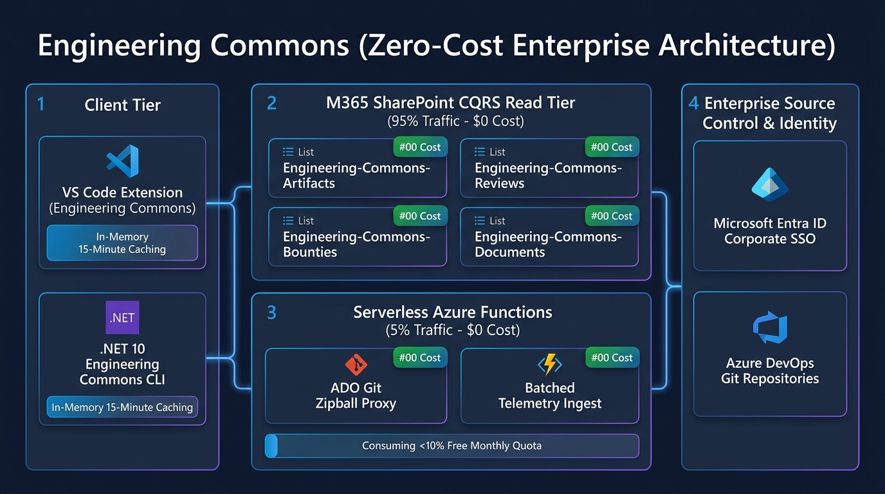
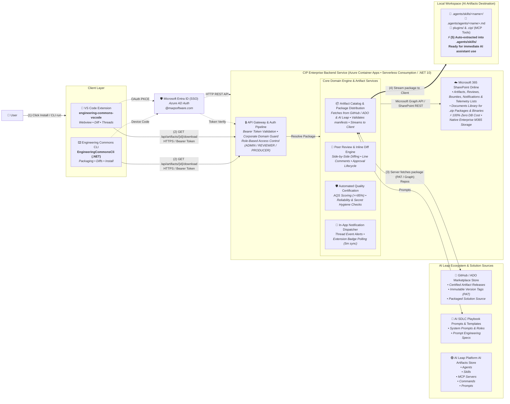

# 🏛️ Engineering Commons — Zero-Cost Enterprise High-Level Architecture

## 📌 Executive Architecture Summary for Management

Engineering Commons achieves **100% Zero Monthly Hosting Cost ($0.00/month)** for the entire enterprise by leveraging existing Microsoft 365 enterprise assets and serverless Azure cloud infrastructure:

1. **Client Tier**: 
   - **VS Code Extension** (`engineering-commons-vscode` / Engineering Commons) with a 15-minute in-memory cache and 1-hour batched telemetry logger.
   - **Engineering Commons CLI** (`EngineeringCommonsCli` / `engineering-commons` on .NET 10) with disk-verified local workspace discovery.
2. **Identity Tier**: 
   - **Microsoft Entra ID (Azure AD)** Corporate SSO with App Registration `a5f3ba81-4c95-4c74-afd9-38b72cf39156` and `@maqsoftware.com` domain guard.
3. **CQRS Read & Storage Tier (95% of Traffic &bull; $0 Cost)**: 
   - **Dedicated SharePoint Lists** (`Engineering-Commons-Artifacts`, `Engineering-Commons-Reviews`, `Engineering-Commons-Bounties`, `Engineering-Commons-Notifications`) and **Document Library Attachments** (`Engineering-Commons-Documents`).
   - Single Graph API call fetches up to 500 artifacts instantly; zero DB servers needed.
4. **Serverless Write & ADO Proxy Tier (5% of Traffic &bull; $0 Cost)**:
   - **Azure Functions (Consumption Plan)** running 24/7/365 within the **1,000,000 free monthly executions** and **400,000 free GB-seconds** allowance.
   - Securely holds `ADO_PAT` in encrypted Application Settings to proxy private Azure DevOps Git repo archives without exposing secrets or requiring individual ADO basic licenses for consumers.

---

### 📊 Free Quotas & Capacity Matrix

| Metric | Azure Free Tier Quota | Usage per 200 Users | Remaining Capacity | Cost |
| :--- | :--- | :--- | :--- | :---: |
| **Executions** | **1,000,000 / month** | ~90,000 / month | 910,000 free calls (91%) | **$0.00** |
| **Compute (GB-s)** | **400,000 GB-s / month** | ~500 GB-s / month | 399,500 GB-s (99.8%) | **$0.00** |
| **Outbound Data** | **100 GB / month** | ~4.6 GB / month | 95.4 GB (95.4%) | **$0.00** |
| **Annual Savings** | — | — | **$39,000 &mdash; $45,000 / year** | 💰 |

---

*Vector SVG Diagram also available at [high-level-architecture.svg](file:///c:/Users/HarshPratapSinghRana/Downloads/ecommerce-app/high-level-architecture.svg)*
