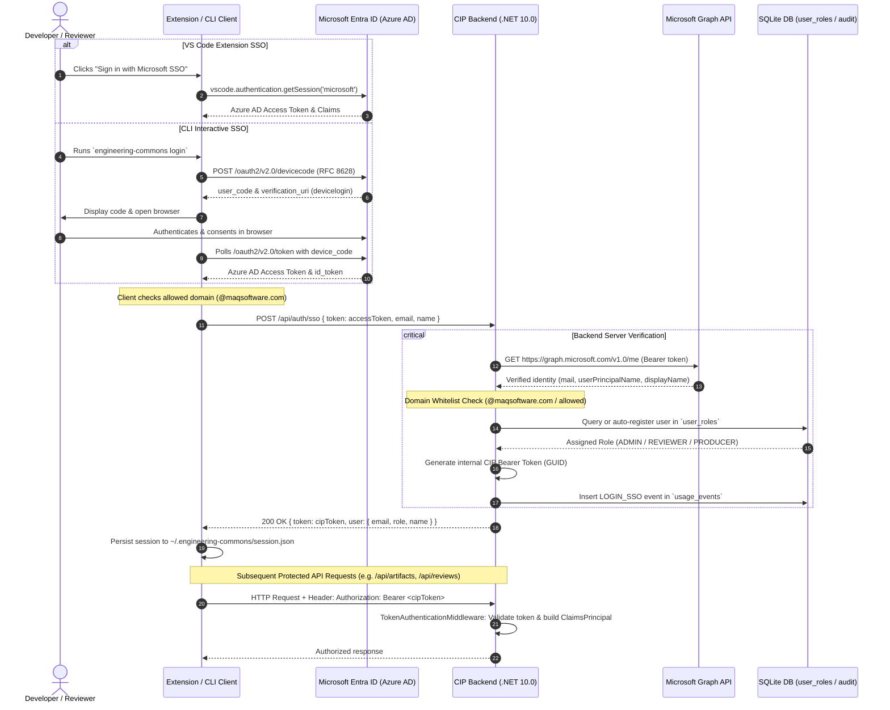

# 🔐 Engineering Commons — Login System & SSO Verification Architecture

This document provides a concise and complete technical explanation of the **Single Sign-On (SSO)** and authentication system across the **VS Code Extension**, **CLI Tool**, and the **.NET Backend Service**.

---

## 1. High-Level Flow Diagram



---

## 2. Client-Side Login Mechanisms

### 2.1 VS Code Extension (`engineering-commons-vscode`)
* **File:** [`engineering-commons-vscode/src/services/ssoService.ts`](file:///c:/Users/HarshPratapSinghRana/Downloads/ecommerce-app/engineering-commons-vscode/src/services/ssoService.ts)
* **How it works:**
  1. **Native VS Code Auth Provider:** Calls VS Code's native authentication API:
     ```typescript
     const session = await vscode.authentication.getSession(
         'microsoft',
         ['User.Read', 'email', 'profile', 'offline_access'],
         { createIfNone: true }
     );
     ```
  2. **Identity Resolution:** Extracts the signed-in corporate email from `session.account.label` or decodes JWT payload claims (`preferred_username`, `upn`, `email`).
  3. **Domain Guard (Client):** Ensures email belongs to `@maqsoftware.com` (or local dev domains `@company.com`, `@test.com`).
  4. **Backend Exchange:** Sends `POST /api/auth/sso` with `{ token: session.accessToken, email, name }`.
  5. **Session Persistence:** Saves the returned CIP token and role to `~/.engineering-commons/session.json`.
  6. **UI Synchronization:** Fires `authProvider.notifyAuthChanged()` to refresh sidebar views and records telemetry.

---

### 2.2 Engineering Commons CLI (`EngineeringCommonsCli`)
* **Files:**
  * [`EngineeringCommonsCli/Commands/LoginCommand.cs`](file:///c:/Users/HarshPratapSinghRana/Downloads/ecommerce-app/EngineeringCommonsCli/Commands/LoginCommand.cs)
  * [`EngineeringCommonsCli/Services/Implementations/MicrosoftSsoAuthService.cs`](file:///c:/Users/HarshPratapSinghRana/Downloads/ecommerce-app/EngineeringCommonsCli/Services/Implementations/MicrosoftSsoAuthService.cs)
  * [`EngineeringCommonsCli/Services/Implementations/BackendClient.cs`](file:///c:/Users/HarshPratapSinghRana/Downloads/ecommerce-app/EngineeringCommonsCli/Services/Implementations/BackendClient.cs)
* **How it works:**
  1. **Default Command:** Running `engineering-commons login` defaults directly to MAQ Microsoft SSO (no password needed).
  2. **Active Session Reuse:** If `~/.engineering-commons/session.json` already has an active session and `--force` is not specified, it authenticates instantly without re-prompting.
  3. **OAuth 2.0 Device Authorization Flow (RFC 8628):**
     * Requests a device code from Microsoft Entra ID:
       `POST https://login.microsoftonline.com/{tenantId}/oauth2/v2.0/devicecode`
     * Displays the user code (e.g. `B9X4K2P1`) and verification URL (`https://microsoft.com/devicelogin`).
     * Automatically launches the default browser for the user.
     * Polls `POST https://login.microsoftonline.com/{tenantId}/oauth2/v2.0/token` with `device_code` every 5 seconds until authorized.
  4. **Direct Token & Credential Fallback:**
     * Automation / CI-CD: `engineering-commons login --token <azure_token> [--email <email>]`
     * Legacy password credentials: `engineering-commons login --credentials`
  5. **Backend Exchange:** Invokes `BackendClient.SsoLoginAsync(accessToken, email, name, role)` calling `POST /api/auth/sso`.
  6. **Session File Sync:** Writes active token, email, and role to `~/.engineering-commons/session.json`.

---

## 3. How the Backend Verifies the User

All SSO verification is handled centrally by the .NET 10.0 Backend in **`AuthController.cs`** and protected by **`TokenAuthenticationMiddleware.cs`**.

### 3.1 Step-by-Step Backend SSO Verification (`POST /api/auth/sso`)
Located in [`cip-backend-dotnet/Controllers/AuthController.cs`](file:///c:/Users/HarshPratapSinghRana/Downloads/ecommerce-app/cip-backend-dotnet/Controllers/AuthController.cs#L66-L215):

```text
Incoming POST /api/auth/sso
    │
    ├─► Step 1: Live Verification via Microsoft Graph API
    │   • Makes HTTP GET to https://graph.microsoft.com/v1.0/me
    │   • Header: Authorization: Bearer <req.Token>
    │   • Cryptographically validates that the token was signed by Microsoft Entra ID
    │   • Extracts authentic user properties: mail, userPrincipalName, displayName
    │
    ├─► Step 2: Fallback JWT Inspection (Offline / Dev / Testing)
    │   • If Graph API is unreachable, decodes the JWT base64 payload
    │   • Inspects claims: preferred_username, upn, email, unique_name
    │   • Rejects if no valid email is found (HTTP 401 Unauthorized)
    │
    ├─► Step 3: Domain Whitelist Guard
    │   • Validates email ends with corporate domain (@maqsoftware.com, @company.com, @test.com)
    │   • Rejects unauthorized external tenants (HTTP 403 Forbidden: domain_forbidden)
    │
    ├─► Step 4: Role Governance via IUserRoleService
    │   • Super Admin Check: harsh.rana@maqsoftware.com -> ADMIN
    │   • Database Lookup: Checks SQLite user_roles table
    │   • First-time auto-provisioning: New users automatically get PRODUCER role
    │
    ├─► Step 5: CIP Session Token Generation & Cache
    │   • Generates internal CIP Bearer Token (Guid)
    │   • Registers mapping in ITokenService (InMemoryTokenService + ~/.engineering-commons/tokens_cache.json)
    │   • Registers both internal CIP token and Microsoft token
    │
    └─► Step 6: Security Audit Log & Response
        • Inserts audit event in usage_events table (Action: LOGIN_SSO, Source: sso_microsoft)
        • Returns HTTP 200 OK:
          {
            "token": "<cip-token>",
            "ssoToken": "<azure-token>",
            "user": { "email": "...", "role": "PRODUCER|ADMIN|REVIEWER", "name": "..." }
          }
```

---

### 3.2 Verification on Subsequent API Requests (`TokenAuthenticationMiddleware`)
Located in [`cip-backend-dotnet/Middleware/TokenAuthenticationMiddleware.cs`](file:///c:/Users/HarshPratapSinghRana/Downloads/ecommerce-app/cip-backend-dotnet/Middleware/TokenAuthenticationMiddleware.cs):

1. **Header Inspection:**
   Every protected API request from CLI or VS Code includes:
   `Authorization: Bearer <cipToken>`
2. **Token Validation (`InMemoryTokenService.cs`):**
   * Checks the in-memory token lookup dictionary.
   * If not cached in memory, reloads from `~/.engineering-commons/tokens_cache.json`.
   * Fallback validation checks `~/.engineering-commons/session.json`.
3. **Claims Identity Injection:**
   When the token matches a registered user, the middleware constructs a `ClaimsPrincipal`:
   ```csharp
   var claims = new[] {
       new Claim(ClaimTypes.Name, user.Email),
       new Claim(ClaimTypes.Role, user.Role)
   };
   var id = new ClaimsIdentity(claims, "Token");
   ctx.User = new ClaimsPrincipal(id);
   ```
4. **Endpoint Enforcement:**
   * Downstream controllers check `User.Identity?.IsAuthenticated`.
   * `User.Identity?.Name` provides the verified email.
   * RBAC operations check `IUserRoleService.IsAdminAsync(email)` or `IsCertifiedReviewerAsync(email)`.
   * Unauthenticated or expired tokens receive `HTTP 401 Unauthorized`.

---

## 4. Role-Based Access Control (RBAC) Summary

| Role | Default Permissions | How Assigned |
| :--- | :--- | :--- |
| **ADMIN** | Full administrative governance, approve access requests, manage user roles, delete/modify artifacts, certifier. | Hardcoded for `harsh.rana@maqsoftware.com` and configured in `AdminEmails`. |
| **REVIEWER / CERTIFIED_REVIEWER** | Review submissions, approve/reject PRs, post inline review threads, vote on certifications. | Granted by Admin via access request workflow (`/api/access-requests/approve`). |
| **PRODUCER** | Search, download, install artifacts, contribute new artifacts, submit versions for review. | Default role automatically assigned to all `@maqsoftware.com` SSO users. |
| **CONSUMER** | Search, view, download, and install published artifacts. | Basic access tier. |

---

## 5. Summary Checklist of Security Controls

* [x] **Zero Credential Exposure:** Passwords are never collected or stored during SSO.
* [x] **Cryptographic Token Verification:** Verified server-to-server with Microsoft Graph API.
* [x] **Strict Corporate Domain Gate:** Non-`@maqsoftware.com` accounts receive `403 Forbidden`.
* [x] **Token Abstraction:** Clients communicate with backend using internal CIP session tokens, isolating external Microsoft tokens.
* [x] **Full Audit Trail:** Every SSO login is persisted with timestamp and user ID into `usage_events`.
