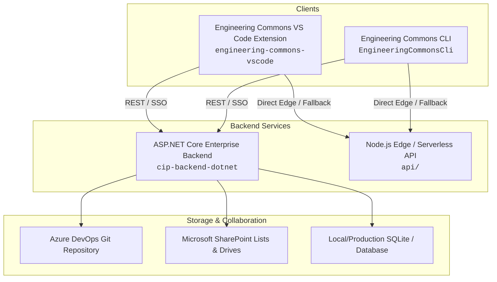

# CIP — Engineering Commons

Enterprise AI Artifact & Capability Registry for Developers and Autonomous AI Agents.

---

## Architecture Overview

The Engineering Commons (CIP) ecosystem is composed of three core tiers:



---

## 1. CLI: `EngineeringCommonsCli`

Cross-platform .NET 10 command-line interface for managing AI skills, agents, MCP servers, and prompt templates.

### Key Capabilities
- **Artifact Discovery & Search**: `engineering-commons list`, `engineering-commons list-versions`
- **Installation & Placement**: `engineering-commons install <artifact-id> [--version <ver>]`
- **AI Certification Engine**: `engineering-commons certify <path-or-id>`
- **Contribution & Publishing**: `engineering-commons contribute <manifest-path>`
- **Review Governance & Slogans**: `engineering-commons review submit`, `engineering-commons review list`
- **Bounties & Innovation Rewards**: `engineering-commons bounty list`, `engineering-commons bounty claim`

### Building & Testing CLI
```bash
cd EngineeringCommonsCli
dotnet build -c Release

# Run CLI unit and integration test suite
dotnet test ../EngineeringCommonsCli.Tests/
```

---

## 2. Backend: `cip-backend-dotnet`

High-performance ASP.NET Core enterprise web API powering registry search, SLA monitoring, multi-factor authentication, SharePoint integration, and review lifecycles.

### Key Capabilities
- **Artifact Governance API**: Access requests, visibility rules, and role-based permissions
- **Certification & Security Discovery**: Static analysis, license verification, manifest validation
- **SharePoint & ADO Synchronization**: Background synchronization with enterprise drives and lists
- **Audit & Usage Telemetry**: Tracking installs, executions, review completions, and token analytics

### Building & Testing Backend
```bash
cd cip-backend-dotnet
dotnet build -c Release

# Run backend unit, integration, and security test suite
dotnet test ../cip-backend-dotnet.Tests/
```

---

## 3. Extension: `engineering-commons-vscode`

Visual Studio Code extension delivering native IDE integration for discovering, previewing, and managing AI artifacts directly inside developer workspaces.

### Key Capabilities
- **Interactive Sidebar & Catalog**: Browse skills, agents, prompt templates, and certified extensions
- **Visual Artifact Inspector**: Comprehensive details, readme viewer, and changelogs
- **Diff & Review Engine**: In-editor side-by-side unified diffs for community artifact reviews
- **Automated CLI Provisioning**: Automatically bootstraps and configures the `engineering-commons` CLI binary and paths

### Compiling Extension
```bash
cd engineering-commons-vscode
npm install
npm run compile
```

---

## Repository Structure

```
├── EngineeringCommonsCli/          # C# .NET 10 CLI Source
├── EngineeringCommonsCli.Tests/    # CLI Unit & Integration Tests (151 tests)
├── cip-backend-dotnet/             # ASP.NET Core Backend API Source
├── cip-backend-dotnet.Tests/       # Backend Unit & Integration Tests (148 tests)
├── engineering-commons-vscode/     # VS Code Extension Source (TypeScript)
├── api/                            # Express / Serverless API & Catalog Index
├── artifacts/                      # Markdown specifications of catalog artifacts
├── artifacts-json/                 # Machine-readable JSON specifications
├── telemetry/                      # Aggregated usage events & tracking logs
├── cip.yml                         # Root workspace artifact manifest
├── cip.lock.yaml                   # Resolved dependency lockfile
├── CIP-ARTIFACT-TEMPLATE.yml       # Specification template for new artifacts
└── README.md                       # Repository documentation
```

---

## License & Governance

Enterprise Internal Use Only. All artifacts subject to the **Engineering Commons AI Artifact Certification Policy & Lifecycle**.
