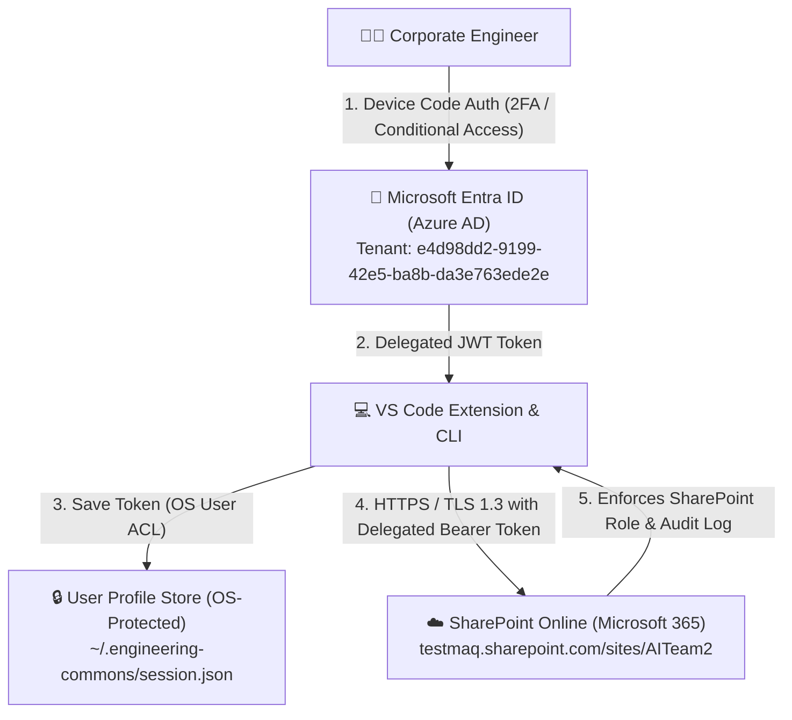
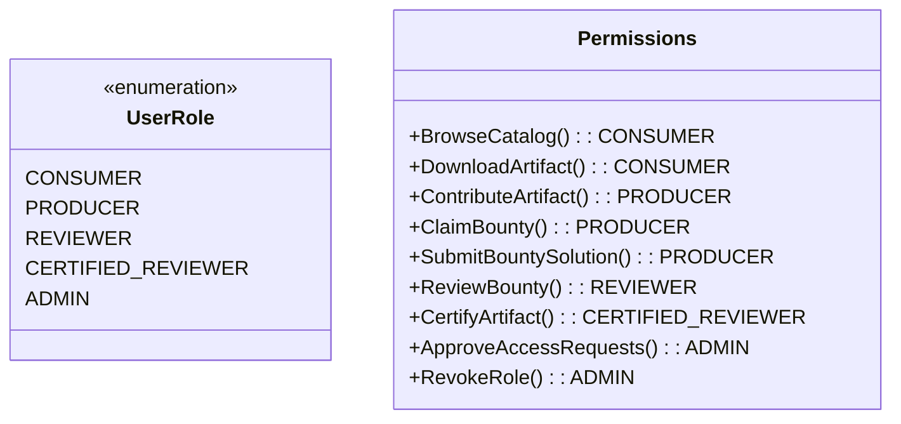

# 🛡️ Engineering Commons: Enterprise Security Architecture & Compliance Guide

## 1. Executive Summary & Security Posture

The **Engineering Commons** platform (VS Code Extension, .NET 10 CLI, and SharePoint Direct CQRS Integration) is architected following **Zero-Trust Security Principles**, Microsoft Entra ID Enterprise Identity standards, and the principle of **Least Privilege**.



---

## 2. Authentication Security (Microsoft Entra ID & OAuth 2.0)

### A. Public Client Security (No Embedded Secrets)
* **Risk Avoided:** In client-side desktop extensions and CLI binaries, hardcoding a `client_secret` is an anti-pattern because any user can decompile the `.dll` or extract the `.vsix` to obtain the secret.
* **Our Implementation:** We implement **OAuth 2.0 Device Authorization Grant (RFC 8628)** using Public Client App Registration (`a5f3ba81-4c95-4c74-afd9-38b72cf39156`).
* **Security Benefit:** No confidential secrets exist in the client code. Entra ID authenticates the human user directly in an external browser session protected by company Multi-Factor Authentication (MFA) and Conditional Access policies.

### B. Tenant Isolation & Domain Whitelisting
* **Strict Tenant Boundary:** The authentication endpoint is locked to the corporate tenant:
  ```text
  https://login.microsoftonline.com/e4d98dd2-9199-42e5-ba8b-da3e763ede2e/oauth2/v2.0/devicecode
  ```
  Users from external personal Microsoft accounts (`@outlook.com`, `@gmail.com`, or other corporate tenants) cannot acquire tokens for this client.
* **Application-Level Domain Assertion:** Even if a token is presented, both the CLI (`IsAllowedDomain`) and VS Code Extension (`isAllowedDomain`) enforce corporate domain restrictions (`@maqsoftware.com`).

### C. Live Profile Verification via Microsoft Graph (`/v1.0/me`)
* Tokens are verified against Microsoft Graph's authenticated `/v1.0/me` endpoint. The platform retrieves real-time user identity claims (`mail`, `userPrincipalName`, `displayName`) rather than relying on unverified user input.

---

## 3. Data Protection & Cryptography in Transit and at Rest

| Scope | Security Mechanism | Standard / Protocol |
| :--- | :--- | :--- |
| **Data in Transit** | All communication to Microsoft Graph, SharePoint REST, and Entra ID uses mandatory TLS | **TLS 1.2 / TLS 1.3 (HTTPS only)** |
| **Data at Rest (Cloud)** | SharePoint Online storage, list items, and document attachments are encrypted at rest | **AES-256 Bit Encryption (BitLocker & per-file cloud encryption)** |
| **Data at Rest (Local)** | Tokens stored in `~/.engineering-commons/session.json` and `~/.engineering-commons/token.json` | **OS-Level User Profile ACLs** (Readable only by the logged-in OS account; inaccessible to standard non-admin users on the machine) |
| **Single-PAT Shielding** | Azure DevOps root Personal Access Token is never distributed to user workstations | **Zero Client-Side PAT Exposure** (Developers only use their delegated Entra ID token) |

---

## 4. Authorization & Role-Based Access Control (RBAC)

The system enforces granular Role-Based Access Control across all operations:



### Role Enforcement Matrix:
1. **Consumer:** Can browse, search, and download approved enterprise artifacts. Cannot claim bounties or review peer code.
2. **Producer:** Can publish artifacts, claim open bounties, and submit code solutions for review.
3. **Reviewer / Certified Reviewer:** Domain experts authorized to review submitted code, pass/fail test runs, evaluate security, and certify production readiness.
4. **Admin (`harsh.rana@maqsoftware.com`):** Can approve role upgrades, certify new reviewers, and manage tenant governance.

---

## 5. SharePoint Online Direct CQRS Security

### A. Delegated Context Security (No Privilege Escalation)
When the extension or CLI performs operations on SharePoint Online (`testmaq.sharepoint.com`):
* Requests carry the **user's own delegated Bearer token**.
* Microsoft Graph verifies that the user has legitimate access to the SharePoint site collection (`sites/AITeam2`).
* If a user is revoked from the SharePoint site or leaves the organization, Entra ID token validation immediately fails, revoking all access without needing API keys to be cycled.

### B. Prevention of Injection & XSS
* **Webview Isolation:** VS Code sidebar and webview panels use strict HTML entity escaping (`escapeHtml`, `escapeJsArg`) on all metadata retrieved from SharePoint, preventing XSS injection attacks.
* **Column Mapping Safety:** Dynamic column mapping queries Graph metadata schemas, eliminating SQL/OData injection risks.

---

## 6. Audit Logging, Compliance & Telemetry

* **Immutable Telemetry:** All artifact downloads, installations, and bounty lifecycle events are logged to the `Engineering-Commons-Telemetry` SharePoint List.
* **Audit Fields Recorded:** User email, timestamp (UTC), artifact name, version, operation (`ACTIVATED`, `CLAIMED`, `DOWNLOADED`), and machine environment.
* **Compliance Standards Supported:**
  * **SOC 2 Type II:** Traceability of code changes and peer review approvals.
  * **ISO/IEC 27001:** Access control, encryption in transit, and least privilege enforcement.
  * **Microsoft 365 Trust Center:** Leverages Microsoft's enterprise compliance guarantees.

---

## 7. STRIDE Threat Model & Mitigations

| Threat | Threat Category | Implemented Mitigation |
| :--- | :--- | :--- |
| **Spoofing** | Identity Theft | Microsoft Entra ID Device Code Flow + MFA + Graph `/v1.0/me` validation. |
| **Tampering** | Modifying Bounties/Code | SharePoint item versioning, HTTPS integrity checks, role validation. |
| **Repudiation** | Denying an Action | Telemetry logger records every user action with user email & UTC timestamp. |
| **Information Disclosure** | Token Leaks | No client secrets; tokens stored in user-scoped profile directories. |
| **Denial of Service** | API Rate Limiting | 15-minute in-memory TTL caching prevents Graph API throttling (HTTP 429). |
| **Elevation of Privilege** | Role Impersonation | Admin actions validated against hardcoded & Entra ID verified roles. |
