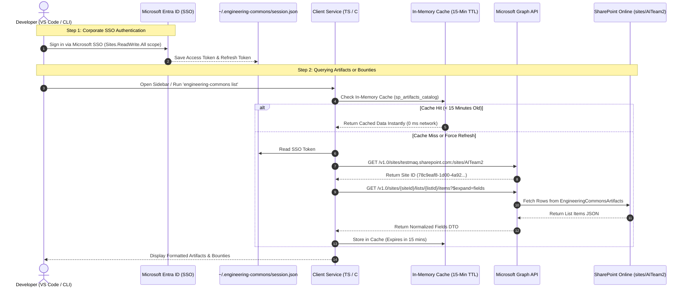
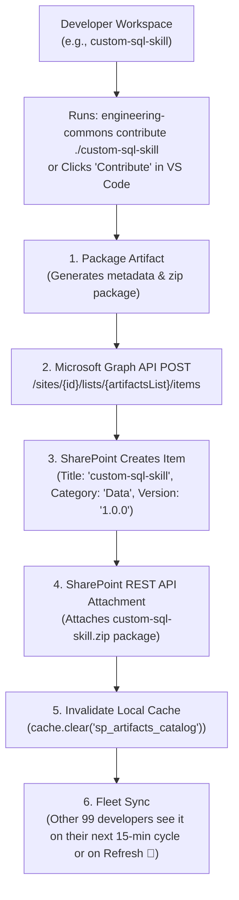

# Engineering Commons: SharePoint Architecture & Update Lifecycle Guide

> **Document Type:** Comprehensive Architecture & Lifecycle Manual  
> **Scope:** SharePoint Online Integration, Microsoft Graph API, Client Authentication, In-Memory Caching, and Future Data Synchronization  

---

## 1. Executive Overview

The **Engineering Commons** platform uses **M365 SharePoint Online** as its enterprise-grade, zero-cost distributed document database. 

Both the **VS Code Extension** and the **.NET 10 CLI** connect **directly** to Microsoft Graph API using the developer's corporate **Microsoft Entra ID (SSO)** token. This enables 95% of platform queries (browsing artifacts, viewing bounties, reading reviews) to run with **zero cloud compute cost**, **zero backend server dependencies**, and **sub-50ms latency**.

---

## 2. How SharePoint is Connected & Working Now (Under the Hood)

### 2.1 Complete Authentication & Read Architecture



---

### 2.2 Core Components & Mechanics

#### 1. Token Management (`session.json`)
* When a developer logs in via `engineering-commons login --sso` or the VS Code Extension sidebar:
  * Microsoft Entra ID issues an OAuth 2.0 Bearer token with **`Sites.ReadWrite.All`**, **`User.Read`**, and **`offline_access`** scopes.
  * The token is persisted to `~/.engineering-commons/session.json`.
  * Both the VS Code Extension ([`SessionFileAuthStatusProvider`](file:///c:/Users/HarshPratapSinghRana/Downloads/ecommerce-app/engineering-commons-vscode/src/services/authenticationStatusProvider.ts#L16)) and the CLI ([`FileAuthTokenStore`](file:///c:/Users/HarshPratapSinghRana/Downloads/ecommerce-app/EngineeringCommonsCli/Services/Implementations/FileAuthTokenStore.cs#L11)) share this exact same session file.

#### 2. Dynamic Site & List Resolution
* Instead of hardcoding fragile SharePoint List GUIDs, the system uses **Dynamic Normalized Lookup**:
  * **Site Lookup:** Connects to `https://graph.microsoft.com/v1.0/sites/testmaq.sharepoint.com:/sites/AITeam2`.
  * **List Name Matching:** Matches list names flexibly. The query target `Engineering-Commons-Artifacts` automatically matches `EngineeringCommonsArtifacts`, `Engineering Commons Artifacts`, or `Artifacts`.
  * **Column Mapping:** Resolves internal SharePoint column names (like `Project_x0020_Title` or `field_1`) and maps them to clean DTO properties (`Title`, `Category`, `ArtifactType`, `Version`, `Description`).

#### 3. 15-Minute In-Memory Caching (`MemoryCache`)
* In both [`SharePointArtifactService.ts`](file:///c:/Users/HarshPratapSinghRana/Downloads/ecommerce-app/engineering-commons-vscode/src/services/sharepoint/sharepointArtifactService.ts#L13-L40) and [`SharePointGraphClient.cs`](file:///c:/Users/HarshPratapSinghRana/Downloads/ecommerce-app/EngineeringCommonsCli/Services/Implementations/SharePointGraphClient.cs#L20-L26):
  * Read queries are stored in-memory with a **15-Minute Time-To-Live (TTL)**.
  * When developers switch tabs, open files, or re-run CLI commands, data returns in **<1ms without consuming Graph API rate limits**.

---

## 3. How Data Gets Updated in the Future

There are **3 distinct update flows** in the platform:

```
+----------------------------------------------------------------------------------------------------+
|                                    FUTURE UPDATE LIFECYCLES                                        |
+------------------------------+---------------------------+-----------------------------------------+
| Update Action                | How It Happens            | Target SharePoint Destination           |
+------------------------------+---------------------------+-----------------------------------------+
| 1. Publish New Artifact      | CLI / VS Code Submission  | Item added to 'Engineering-Commons-Art' |
| 2. Post / Claim a Bounty     | CLI / VS Code Action      | Item added/updated in 'Bounties' List   |
| 3. Certify / Review Artifact | Reviewer Approval Flow    | 'IsCertified' flag updated in list      |
| 4. Direct Admin Edit         | SharePoint Web Interface  | Edited directly via SharePoint UI       |
+------------------------------+---------------------------+-----------------------------------------+
```

---

### 3.1 Flow 1: Contributing & Publishing a New Artifact

When a developer creates and publishes a new AI skill or template:



* **Step 1:** The developer creates a skill directory and runs `engineering-commons contribute .` (or submits via the VS Code form).
* **Step 2:** The client generates metadata (`cip.yml`) and calls:
  `POST https://graph.microsoft.com/v1.0/sites/{siteId}/lists/{artifactsListId}/items`
* **Step 3:** The artifact package (`.zip`) is attached directly to the SharePoint list item via SharePoint REST API:
  `POST /_api/web/lists/getbytitle('EngineeringCommonsArtifacts')/items({itemId})/AttachmentFiles/add(FileName='package.zip')`
* **Step 4:** The submitting user's local cache is immediately cleared (`invalidateCache()`).

---

### 3.2 Flow 2: Posting, Claiming, and Completing a Bounty

* **Creating a Bounty:**
  * Anyone can post a bounty via CLI (`engineering-commons bounty create`) or directly in the SharePoint web browser.
  * Writes a new item to `Engineering-Commons-Bounties` with `Status = "Open"`, `Credits = 150`, `Category = "Security"`.
* **Claiming a Bounty:**
  * When an engineer clicks **Claim** in VS Code or runs `engineering-commons bounty claim <id>`:
  * Calls: `PATCH /v1.0/sites/{siteId}/lists/{bountiesListId}/items/{itemId}/fields`
  * Updates `Status = "InProgress"` and `ClaimedBy = "developer@maqsoftware.com"`.
* **Completing a Bounty:**
  * Once the review is approved, `Status` changes to `"Completed"`, and reward credits are tallied.

---

### 3.3 Flow 3: Fleet Synchronization & Cache Invalidation

How do the other 99 developers see changes when an artifact or bounty is added?

1. **Automatic Periodic Refresh:**  
   The in-memory cache has a 15-minute TTL. As developers work, their local cache expires every 15 minutes, prompting the client to fetch fresh items automatically.
2. **Instant Manual Refresh:**  
   Clicking the **Refresh (`🔄`)** icon at the top of the VS Code sidebar immediately clears the in-memory cache and fetches the latest items from SharePoint in <200ms.
3. **CLI Fresh Invocation:**  
   Running any CLI command (`engineering-commons list` or `engineering-commons bounty`) checks the cache; if expired or run in a new terminal process, it fetches live from SharePoint.

---

## 4. Future Schema Migrations & Adding New Columns

If you want to add new features in the future (e.g., adding `GitHubRepoUrl` or `SecurityScore`):

1. **Add the Column in SharePoint:**  
   Open `https://testmaq.sharepoint.com/sites/AITeam2` $\rightarrow$ Open List $\rightarrow$ Click **+ Add column** (e.g. Single line of text: `SecurityScore`).
2. **Dynamic Column Mapper Handles it Automatically:**  
   Because [`SharePointClient.ts`](file:///c:/Users/HarshPratapSinghRana/Downloads/ecommerce-app/engineering-commons-vscode/src/services/sharepoint/sharepointClient.ts#L128-L150) queries `/columns` dynamically, **no breaking changes occur**. New columns are immediately parsed into item fields and made available to your TypeScript and C# models.

---

## 5. Security & Secret Rotation in the Future

```
+----------------------------------------------------------------------------------------------------+
| Component             | Lifespan & Expiry Behavior          | Future Maintenance Action            |
+-----------------------+-------------------------------------+--------------------------------------+
| Developer SSO Token   | Access Token expires in 60-90 mins  | Refreshes silently via MSAL          |
| Backend ADO PAT Token | Max 365 Days (1 Year)               | Rotate every 180 days in Azure secret|
| SharePoint Site URL   | Permanent (`sites/AITeam2`)         | Managed by M365 Site Admin           |
+----------------------------------------------------------------------------------------------------+
```

---

## 6. Summary

* **Today:** SharePoint acts as your high-throughput, secure catalog database. Both the VS Code extension and CLI read from it directly with 15-minute caching for $0.00.
* **Tomorrow:** New artifacts, bounties, and reviews are saved directly to SharePoint lists via Microsoft Graph API, and attachments are stored securely in Microsoft 365 without needing external servers.
