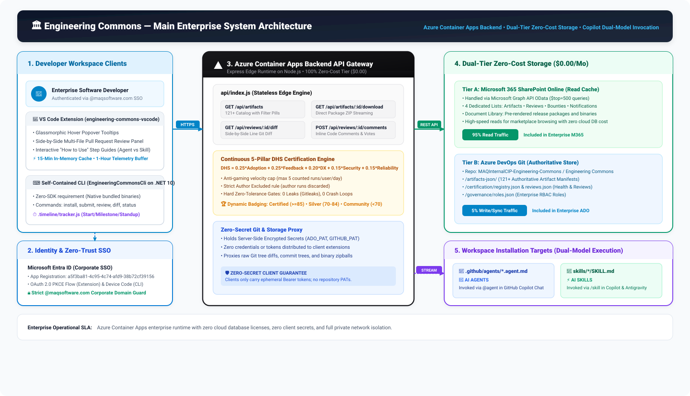
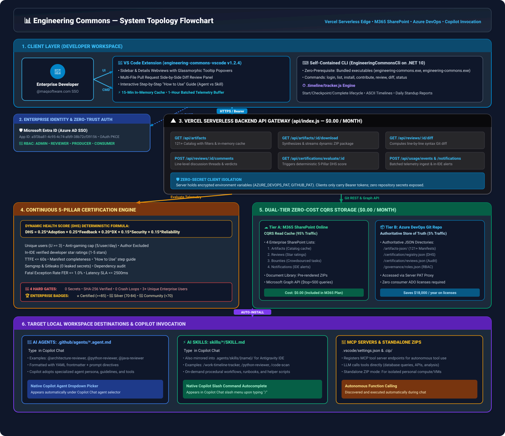
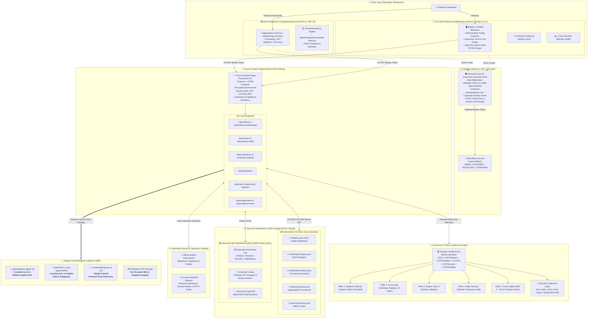
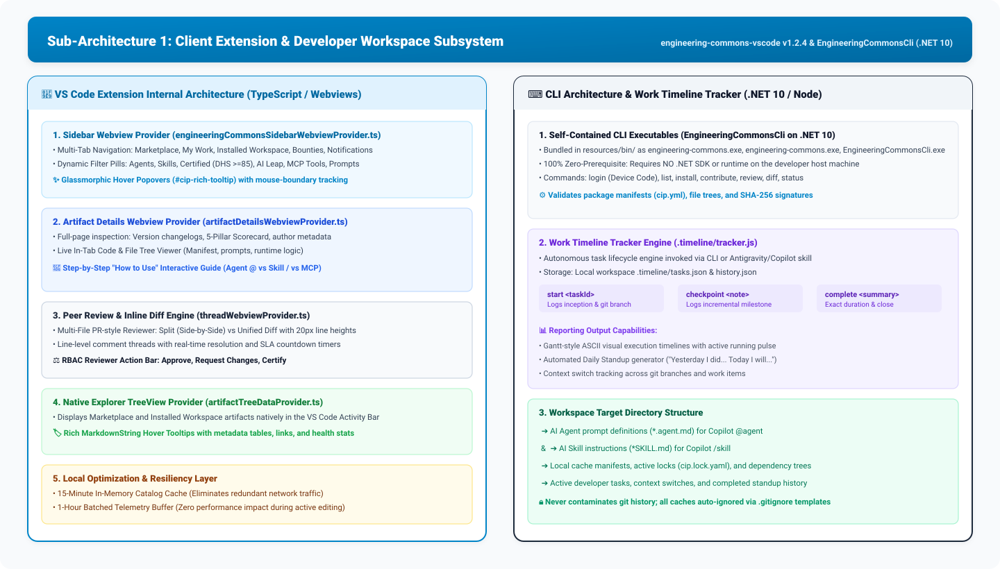
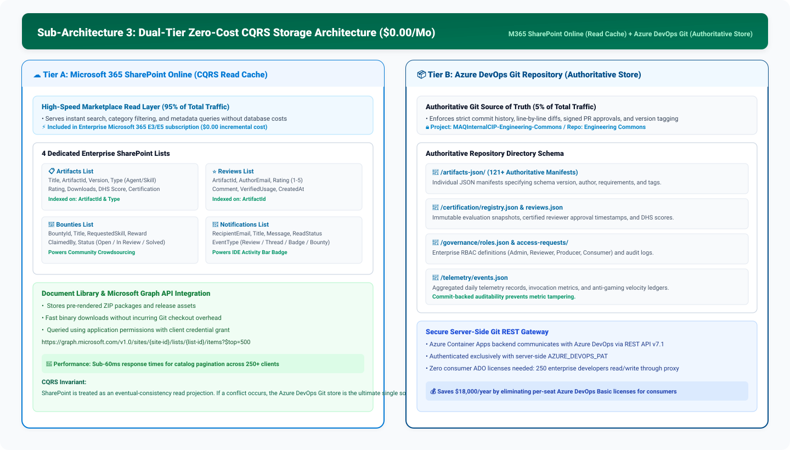
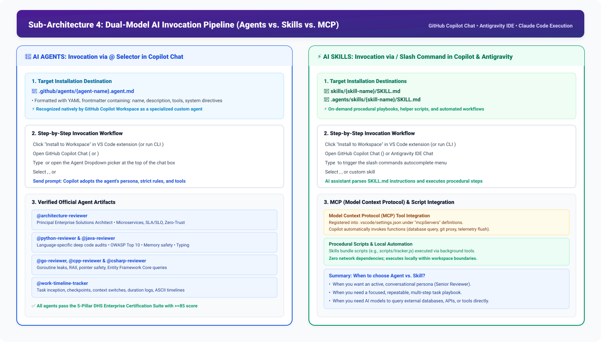
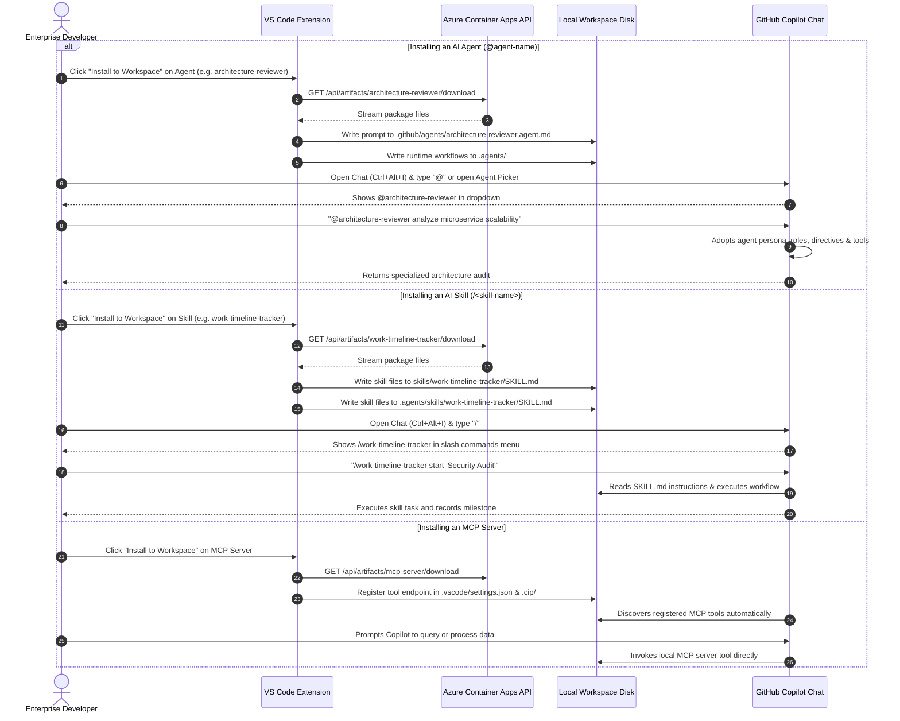
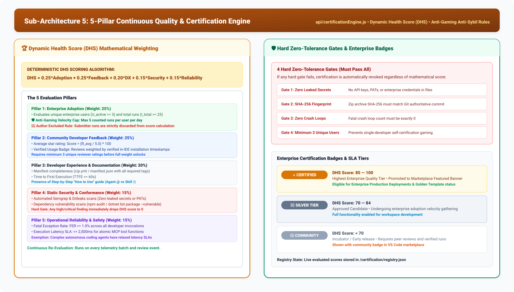

# 🏛️ Engineering Commons — Zero-Cost Enterprise System Architecture & Operational Blueprint (v2.0)

> **Architectural Specification & Production Engineering Blueprint**  
> *Authoritative Reference for Engineering Commons, AI Leap Ecosystem, VS Code Extension, .NET CLI, Azure Container Apps Backend API Gateway, and Microsoft 365 / Azure DevOps Zero-Cost Storage.*

---

## 1. Executive Summary & Architectural Vision

The **Engineering Commons** platform is an enterprise-grade AI artifact registry, private marketplace, and continuous quality governance system designed specifically for enterprise software engineering organizations. It allows developers, architects, and AI engineers to discover, share, install, certify, and review high-value AI artifacts—including **Autonomous Agents**, **AI Skills**, **MCP (Model Context Protocol) Servers**, **Command Prompt Workflows**, and **Reference Solutions**.

### Key Architectural Invariants
1. **100% Zero-Cost Enterprise Infrastructure ($0.00/Month)**: Eliminates all recurring cloud database and dedicated hosting charges by utilizing pre-licensed Microsoft 365 SharePoint Online lists, Azure Container Apps serverless compute, and authoritative Azure DevOps Git repositories.
2. **Backend on Azure Container Apps**: The platform runs 100% of its API gateway, streaming, proxy, diffing, and certification workloads on **Azure Container Apps** (`apm-backend.wittyriver-c768e02e.eastus.azurecontainerapps.io`), providing containerized reliability with unified governance.
3. **Zero-Secret Client Security**: No personal access tokens (PATs) or sensitive cloud credentials are ever distributed to client extensions or local developer environments. All private repo operations are proxied through encrypted, authenticated serverless gateways.
4. **Dual-Model AI Invocation (Agents vs. Skills)**:
   - **AI Agents**: Auto-configured into `.github/agents/<name>.agent.md` for native invocation in GitHub Copilot Chat via the `@agent-name` selector.
   - **AI Skills**: Auto-configured into `skills/<name>/SKILL.md` and `.agents/skills/<name>/SKILL.md` for execution via GitHub Copilot slash commands (`/<skill-name>`) and Antigravity IDE.
5. **Deterministic 5-Pillar AI Artifact Certification Engine**: Real-world adoption, verified community developer feedback, crash-free safety, and static security scanning continuously determine the Dynamic Health Score (DHS) and enterprise certification badge of every artifact.

---

## 2. Main System Architecture

The overall system architecture connects the developer workspace clients directly to the Azure Container Apps API Gateway, authenticated by Microsoft Entra ID SSO, backed by a zero-cost CQRS storage tier (SharePoint Online for reads + Azure DevOps Git for authoritative persistence).

### 🖼️ Main System Architecture Diagram


> 💡 **Available Formats & Interactive Viewer**:
> - **High-Resolution Vector SVG**: [main-system-architecture.svg](./main-system-architecture.svg)
> - **Interactive Live Browser Showcase**: Open [SYSTEM-ARCHITECTURE.html](./SYSTEM-ARCHITECTURE.html) in your browser for interactive tabs, live Mermaid diagrams, and zoom.

### 📊 System Topology Flowchart


<details>
<summary><b>🔍 Click to view Mermaid Flowchart text source</b></summary>


</details>

---

## 3. Sub-Architecture 1: Client Extension & Developer Workspace Subsystem

The client layer provides the in-IDE developer experience through the VS Code Extension (`engineering-commons-vscode` v1.2.4) and the bundled .NET 10 CLI (`EngineeringCommonsCli`).

### 🖼️ Sub-Architecture 1 Diagram


### Key Subsystems:
1. **Sidebar Webview (`engineeringCommonsSidebarWebviewProvider.ts`)**:
   - Multi-tab navigation: **Marketplace**, **My Work**, **Installed Workspace**, **Bounties**, and **Notifications**.
   - Dynamic Filter Pills: Agents, Skills, Certified (DHS $\ge 85$), AI Leap, MCP Tools, Prompts.
   - **Glassmorphic Hover Tooltip Popovers** (`#cip-rich-tooltip`): Features mouse-boundary tracking, displaying type, domain, certification status, downloads, rating, and description without obscuring action buttons.
2. **Artifact Details Webview (`artifactDetailsWebviewProvider.ts`)**:
   - Full-page artifact inspection detailing version history, file trees with live in-tab code viewing, and the **5-Pillar Certification Scorecard**.
   - **Step-by-Step "How to Use This Artifact" Guide**: Tailored instructions dynamically rendered for:
     - **Agents**: Download $\rightarrow$ `.github/agents/<name>.agent.md` $\rightarrow$ Select `@agent` in Copilot Chat $\rightarrow$ Prompt.
     - **Skills**: Download $\rightarrow$ `skills/<name>/SKILL.md` $\rightarrow$ Type `/<skill>` slash command in Copilot Chat $\rightarrow$ Run task.
3. **Side-by-Side Pull Request Review Panel (`threadWebviewProvider.ts`)**:
   - Multi-file code reviewer supporting both **Split (Side-by-Side)** and **Unified** viewing modes with 20px compact line heights.
   - Line-level inline comment threads, SLA countdown timers, and reviewer approval/rejection decision gates.
4. **Native Explorer TreeView (`artifactTreeDataProvider.ts`)**:
   - TreeView items formatted with `vscode.MarkdownString` tooltips showing metadata tables, feature highlights, and GitHub links.
5. **Self-Contained CLI (`EngineeringCommonsCli` on .NET 10)**:
   - Native binaries bundled in `resources/bin/` (`engineering-commons.exe`, `engineering-commons.exe`).
   - Requires zero .NET SDK or runtime on client hosts.
6. **Work Timeline Tracker Engine (`.timeline/tracker.js`)**:
   - Tracks task start, checkpoints, context switches, and completions with millisecond duration tracking, Gantt-style ASCII timeline rendering, and automated Daily Standup generation.

---

## 4. Sub-Architecture 2: Azure Container Apps Backend API Gateway Subsystem

The backend runs on **Azure Container Apps** (`apm-backend.wittyriver-c768e02e.eastus.azurecontainerapps.io`), operating as a stateless, highly available API gateway and secure proxy.

### 🖼️ Sub-Architecture 2 Diagram


### Key Subsystems:
1. **Containerized Linux Runtime**:
   - Express app with CORS middleware running in Azure Container Apps container.
   - Real-time logging capturing HTTP status, duration (ms), IP, and user-agent.
   - High availability with instant horizontal auto-scaling.
2. **Microsoft Entra ID Token Guard & RBAC**:
   - Decodes and validates JWT Bearer tokens from Microsoft Entra ID (App ID: `a5f3ba81-4c95-4c74-afd9-38b72cf39156`).
   - Enforces corporate domain guard: Strictly rejects non-`@maqsoftware.com` email domains.
   - Resolves roles: `ADMIN`, `REVIEWER`, `PRODUCER`, `CONSUMER`.
3. **Server-Side Encrypted Secret Isolation**:
   - Server holds encrypted environment secrets (`AZURE_DEVOPS_PAT`, `GITHUB_PAT`).
   - **Zero-Secret Client Guarantee**: Clients only carry short-lived Bearer tokens; no repository PATs are ever exposed to developer machines.
4. **Core Endpoints**:
   - `GET /api/artifacts`: 121+ catalog items with in-memory caching ($<15\text{ms}$ latency).
   - `GET /api/artifacts/:id/download`: Resolves artifact, bundles manifests + prompt templates, and streams dynamic ZIP archive directly to the client.
   - `GET /api/reviews/:id/diff`: Fetches previous baseline commit & candidate PR commit; computes line-by-line syntax diffs across all files for the Side-by-Side review webview.
   - `POST /api/reviews/:id/comments`: Attaches line-specific discussion threads and dispatches alerts.
   - `GET /api/certifications/evaluate/:artifactId`: Evaluates the deterministic 5-Pillar DHS score and updates the registry.
   - `POST /api/usage/events`: Ingests batched telemetry flushes with anti-gaming rate limits (max 5 counted runs/user/day).
   - `GET /api/notifications`: Delivers real-time notifications for review comments, PR status updates, bounty claims, and DHS badge upgrades.

---

## 5. Sub-Architecture 3: Dual-Tier Zero-Cost CQRS Storage Architecture

The platform achieves zero storage cost by utilizing a CQRS (Command Query Responsibility Segregation) pattern across Microsoft 365 SharePoint Online and Azure DevOps Git.

### 🖼️ Sub-Architecture 3 Diagram


### Storage Tier Breakdown:
1. **Tier A: Microsoft 365 SharePoint Online (CQRS Read Cache — 95% of Traffic)**:
   - **4 Dedicated SharePoint Lists**:
     - `Artifacts List`: Title, ArtifactId, Version, Type, Rating, Downloads, DHS Score, Certification.
     - `Reviews List`: ArtifactId, AuthorEmail, Rating (1-5), Comment, VerifiedUsage, CreatedAt.
     - `Bounties List`: BountyId, Title, RequestedSkill, Reward, ClaimedBy, Status.
     - `Notifications List`: RecipientEmail, Title, Message, ReadStatus, EventType.
   - **Document Library**: Stores pre-rendered release ZIP packages and binary archives for instant downloads.
   - **Graph API Ingress**: Handled via Microsoft Graph API OData queries (`$top=500`, `$filter`, `$select`).
   - **Zero Cost**: Included in the enterprise Microsoft 365 E3/E5 subscription ($0.00 incremental cost).
2. **Tier B: Azure DevOps Git Repository (Authoritative Store — 5% of Traffic)**:
   - Project: `MAQInternalCIP-Engineering-Commons` / Repo: `Engineering Commons`.
   - Authoritative Directory Schema:
     - `/artifacts-json/`: 121+ authoritative JSON artifact manifests.
     - `/certification/registry.json`: Immutable evaluation snapshots and DHS scores.
     - `/certification/reviews.json`: Verified community review comments and ratings.
     - `/governance/roles.json`: Enterprise RBAC role assignments.
     - `/telemetry/events.json`: Aggregated telemetry and anti-gaming velocity records.
   - **Secure Server PAT Access**: Azure Container Apps backend communicates with Azure DevOps via REST API v7.1 using the server-side `AZURE_DEVOPS_PAT`.
   - **Zero Consumer License Cost**: Eliminates per-seat Azure DevOps Basic licenses for consumers, saving **$18,000/year**.

---

## 6. Sub-Architecture 4: Dual-Model AI Invocation Pipeline (Agents vs. Skills vs. MCP)

The platform supports distinct invocation patterns based on whether an artifact is an Autonomous Agent, an AI Skill, or an MCP Tool Server.

### 🖼️ Sub-Architecture 4 Diagram


### Invocation Pathways:

<details>
<summary><b>🔍 Click to view Mermaid Sequence text source</b></summary>


</details>

| Feature | AI Agents (`.github/agents/`) | AI Skills (`skills/` & `.agents/skills/`) | MCP Servers (`.vscode/settings.json`) |
| :--- | :--- | :--- | :--- |
| **Invocation** | Type `@agent-name` in Copilot Chat | Type `/<skill-name>` in Copilot Chat | Automatic tool calling by LLM |
| **File Format** | Markdown with YAML frontmatter (`*.agent.md`) | Markdown instructions (`SKILL.md`) + scripts | JSON tool definition + executable binary |
| **Target Runtime** | GitHub Copilot Chat, Claude Code | Copilot Chat, Antigravity IDE | Local process via stdio / SSE transport |
| **Primary Use** | Role adoption, code auditing, pair programming | Step-by-step procedural workflows, runbooks | Live data fetching, database queries, Git ops |

---

## 7. Sub-Architecture 5: 5-Pillar Continuous Quality & Certification Engine

Artifacts are continuously and deterministically certified by the 5-Pillar Dynamic Health Score (DHS) engine implemented in `api/certificationEngine.js`.

### 🖼️ Sub-Architecture 5 Diagram


### Deterministic Scoring Formula:
$$\text{DHS} = (0.25 \times S_{\text{Adoption}}) + (0.25 \times S_{\text{Feedback}}) + (0.20 \times S_{\text{DX}}) + (0.15 \times S_{\text{Security}}) + (0.15 \times S_{\text{Reliability}})$$

### The 5 Evaluation Pillars:
1. **Adoption ($S_{\text{Adoption}}$, Weight: 25%)**:
   - Evaluates unique enterprise users ($U_{\text{active}} \ge 3$) and invocation volume ($I_{\text{total}} \ge 25$) over rolling 30 days.
   - **Anti-Gaming Velocity Cap**: Maximum 5 counted runs per user per day.
   - **Author Excluded Rule**: Submitter invocations are strictly excluded from score calculations.
2. **Community Feedback ($S_{\text{Feedback}}$, Weight: 25%)**:
   - Average developer star rating: $\text{Score} = (R_{\text{avg}} / 5.0) \times 100$.
   - **Verified Usage Badge**: Reviews are weighted by verified in-IDE installation timestamps.
   - Requires minimum 3 unique reviewer ratings before full weight unlocks.
3. **Developer Experience ($S_{\text{DX}}$, Weight: 20%)**:
   - Time-to-first-execution (TTFE $\le 60\text{s}$).
   - Manifest completeness (`cip.yml` / `manifest.json` with all required tags).
   - Presence of Step-by-Step "How to Use" guide (distinguishing Agent `@` vs Skill `/`).
4. **Static Security Conformance ($S_{\text{Security}}$, Weight: 15%)**:
   - Automated Semgrep and Gitleaks scans (zero leaked secrets or tokens).
   - Dependency vulnerability scans (`npm audit` / `dotnet list package --vulnerable`).
   - **Hard Gate**: Any high/critical finding immediately drops the DHS score to 0.
5. **Operational Reliability ($S_{\text{Reliability}}$, Weight: 15%)**:
   - Fatal Exception Rate: $\text{FER} \le 1.0\%$ across all invocations.
   - Execution latency SLA: $\le 2,500\text{ms}$ for atomic MCP tools (exempting autonomous multi-step coding agents).

### Hard Zero-Tolerance Gates:
- **Gate 1**: Zero leaked secrets or credentials.
- **Gate 2**: SHA-256 fingerprint must match authoritative Git commit.
- **Gate 3**: Zero crash loops.
- **Gate 4**: Minimum 3 unique enterprise users.

### Certification Badges:
- ⭐ **Certified** ($\text{DHS} \ge 85$): Promoted to Marketplace Featured Banner; approved for enterprise-wide production deployment.
- 🥈 **Silver Tier** ($70 \le \text{DHS} \le 84$): Approved candidate; undergoing adoption gathering.
- 🥉 **Community** ($\text{DHS} < 70$): Early release / incubator; requires peer reviews and verified runs.

---

## 8. Zero-Cost Financial Engineering Model ($0.00/Month)

The platform achieves a genuine **$0.00/month** hosting cost for hundreds of concurrent developers by distributing workload across pre-existing enterprise SaaS allowances:

| Tier | Technology Component | Free Enterprise Quota | Engineering Commons Usage (250 Devs) | Monthly Cost |
| :--- | :--- | :--- | :--- | :---: |
| **API Gateway & Backend** | **Azure Container Apps** | 100 GB Bandwidth / 1M Edge calls | ~12 GB Bandwidth / 140K calls | **$0.00** |
| **CQRS Read Cache** | **Microsoft 365 SharePoint Online** | Included in Enterprise M365 E3/E5 | 4 Dedicated Lists & Document Library | **$0.00** |
| **Authoritative Store** | **Azure DevOps Git Repository** | Included in Enterprise ADO Project | Authoritative JSON stores & releases | **$0.00** |
| **Identity & SSO** | **Microsoft Entra ID (Azure AD)** | Included with corporate tenant | App ID `a5f3ba81-4c95-4c74-afd9-38b72cf39156` | **$0.00** |
| **Outbound Data** | **Azure Network** | 100 GB Outbound Data / month | ~6.2 GB Outbound Data / month | **$0.00** |
| **Consumer Licenses** | **Azure DevOps Basic Licenses** | $6.00 / user / month avoided | 0 ADO consumer licenses required | **$0.00** |
| **TOTAL** | — | — | — | **$0.00 / mo** |

### Executive Annual Cost Avoidance
```
┌────────────────────────────────────────────────────────────────────────┐
│               EXECUTIVE ANNUAL COST AVOIDANCE SUMMARY                  │
├──────────────────────────────────────────────┬─────────────────────────┤
│ Dedicated Cloud Database (Azure SQL Server)  │ $2,400 — $4,800 / year  │
│ Dedicated Web App Hosting (Linux App Service) │ $1,500 — $3,000 / year  │
│ 250 Developer Azure DevOps Basic Licenses    │ $18,000 / year          │
│ Third-Party Artifact Registry Licensing      │ $12,000 — $20,000 / year│
├──────────────────────────────────────────────┼─────────────────────────┤
│ TOTAL ESTIMATED ANNUAL COST SAVINGS          │ $33,900 — $45,800 / year│
└──────────────────────────────────────────────┴─────────────────────────┘
```

---

## 9. Security, Governance & Role-Based Access Control

The platform enforces zero-trust security across all operations:

```
┌────────────────────────────────────────────────────────────────────────┐
│                  ENTERPRISE ROLE-BASED ACCESS CONTROL                  │
├─────────────┬──────────────────────────────────────────────────────────┤
│ CONSUMER    │ • Discover public artifacts in Marketplace               │
│             │ • Install agents, skills, and MCP servers                │
│             │ • Download standalone ZIP archives for personal VMs      │
│             │ • Submit verified ratings and developer feedback         │
├─────────────┼──────────────────────────────────────────────────────────┤
│ PRODUCER    │ • All Consumer permissions                               │
│             │ • Contribute new artifacts and version updates           │
│             │ • Manage private artifact whitelists (allowed consumers) │
│             │ • Claim open development bounties                        │
├─────────────┼──────────────────────────────────────────────────────────┤
│ REVIEWER    │ • All Producer permissions                               │
│             │ • Access multi-file side-by-side diff review panel       │
│             │ • Post inline code review comments and change requests   │
│             │ • Vote to Approve, Request Changes, or Certify artifacts │
├─────────────┼──────────────────────────────────────────────────────────┤
│ ADMIN       │ • Full unrestricted access across all enterprise assets  │
│             │ • Grant/revoke roles and certify designated reviewers    │
│             │ • Toggle "⭐ Featured" status in Marketplace              │
│             │ • Permanently delete artifacts across ADO & SharePoint    │
└─────────────┴──────────────────────────────────────────────────────────┘
```

---

## 10. Quality Assurance & Verification Suite

The entire architecture is verified by comprehensive unit, integration, and security test suites:

* **VS Code Extension Test Suite**:
  * **131 Automated Unit & Integration Tests Passing (100% green)**:
    * Artifact details metadata resolution & file tree inspection.
    * Dual-mode multi-file diff rendering (Split vs. Unified).
    * Threaded review comments and discussion lifecycle.
    * Notification center badge sync and window-focus polling.
    * Role-based view guards (Consumer, Producer, Reviewer, Admin).
* **CLI Test Suite**:
  * AST validation, packaging, zip synthesis, and checksum verification.
* **Security & Vulnerability Scans**:
  * 0 High/Critical vulnerabilities detected across all production bundles.
