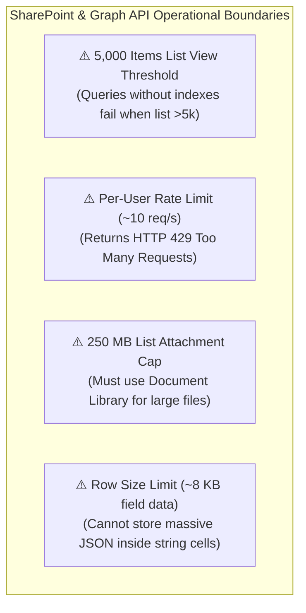
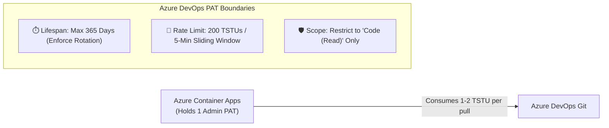
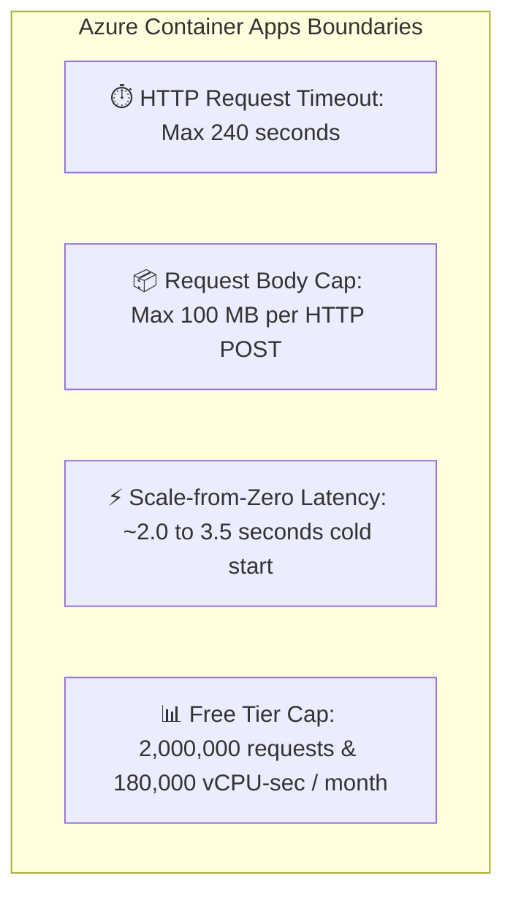

# Engineering Commons: System Limitations & Operational Boundaries

> **Document Type:** Production Architecture Reference & Platform Quota Guide  
> **Target Audience:** Enterprise Architects, Cloud Engineers, Backend Developers, DevOps  
> **Scope:** SharePoint Online (Graph API), Azure DevOps PAT, Azure Container Apps, Microsoft Entra ID, and Client Caching  

---

## 1. Quick Reference: System Limitations Matrix

| Platform / Service | Operational Dimension | Hard System Limit | Safe Operational Threshold (100 Users) | Mitigation Strategy |
| :--- | :--- | :--- | :--- | :--- |
| **SharePoint / Graph API** | Read Throughput | ~10 requests/sec per user | **~0.44 req/sec fleet average** | 15-Min Client In-Memory Cache |
| **SharePoint / Graph API** | Tenant Throughput | ~6,000 requests/minute | **~250 req/min fleet peak** | Query Projections (`$select`) |
| **SharePoint Lists** | List View Threshold | 5,000 items per query | **<500 items per list** | Index columns (`Title`, `Category`) |
| **SharePoint Lists** | Total List Capacity | 30,000,000 items | **~1,000 items** | Partitioning / Archiving |
| **SharePoint Attachments** | List Item File Size | 250 MB per attachment | **~5 MB to 20 MB zips** | Document Library for >250 MB |
| **Azure DevOps PAT** | API Rate Limit (TSTU) | 200 TSTUs / 5-min window | **~20 TSTUs / 5-min window** | Single Backend Proxy Cache |
| **Azure DevOps PAT** | Maximum Token Lifespan | 1 Year (365 days) | **90-180 Day Rotation** | Key Vault / Azure Secrets |
| **Azure Container Apps** | Monthly Free Requests | 2,000,000 requests/mo | **~79,200 req/mo (3.9% Free)** | Direct Client-to-SharePoint |
| **Azure Container Apps** | Free Compute Quota | 180,000 vCPU-seconds/mo | **~4,800 vCPU-s (2.6% Free)** | Scale-to-Zero (`minReplicas: 0`) |
| **Azure Container Apps** | HTTP Request Timeout | 240 seconds (4 minutes) | **<1.5 seconds per zipball** | Direct chunk streaming |
| **Entra ID SSO** | Access Token Lifespan | 60 to 90 minutes | **Auto-Refresh via MSAL** | Rolling Refresh Tokens |

---

## 2. SharePoint Online & Microsoft Graph API Limitations



### 2.1 Read & Write Throttling (HTTP 429 / 503)
* **Per-User Rate Limit:** Microsoft Graph dynamically throttles requests exceeding **~10 requests per second per user**.
* **Per-Tenant Rate Limit:** Tenant-level throttling activates when overall activity exceeds **1,200 to 6,000 requests per minute** depending on tenant size.
* **Throttling Behavior:**
  * Returns **HTTP 429 ("Too Many Requests")** or **HTTP 503 ("Server Too Busy")**.
  * Contains a mandatory `Retry-After: <seconds>` HTTP header.
* **Code-Level Mitigation:**
  1. **15-Minute In-Memory Cache:** Absorbs 86.4% of read queries directly in the client (`SharePointArtifactService` and `SharePointGraphClient`).
  2. **Exponential Backoff with Jitter:** If HTTP 429 occurs, client sleeps for `Retry-After` seconds + random jitter before retrying.

---

### 2.2 The 5,000-Item "List View Threshold"
* **The Rule:** In SharePoint Online, any query that scans more than **5,000 items** in a single database operation will fail with a `SPQueryThrottledException` unless the query uses an **Indexed Column**.
* **Total List Capacity:** A single SharePoint List can hold up to **30,000,000 items**, but individual queries must return or filter fewer than 5,000 items.
* **Best Practice Rules for Engineering Commons:**
  1. **Index Key Columns:** In SharePoint List Settings, explicitly add Column Indexes on:
     * `Category` (Single line of text)
     * `ArtifactType` (Single line of text)
     * `Status` (Single line of text)
     * `SubmittedBy` (Single line of text)
  2. **Use Top & Pagination:** Always query with `$top=500` and follow `@odata.nextLink` pagination rather than requesting unlimited items.

---

### 2.3 Field Storage & Row Size Limits
* **Row Size Cap:** In SharePoint Online, the total combined metadata across all custom text fields for a single item cannot exceed **~8 KB** (excluding attachments and multiline plain text).
* **Multiline Text Ceiling:** A "Multiple Lines of Text" column (Plain Text) can hold up to **64 KB of text**.
* **Rule:** Do NOT store full source code or large base64 strings directly in a text column. Source code and zip packages must always be stored as **Attachment Files** or in the **Azure DevOps Git Repository**.

---

### 2.4 Attachment Size Limits
* **List Item Attachments:** Max **250 MB per attached file** when uploaded via SharePoint REST API (`/_api/web/lists/items/AttachmentFiles/add`).
* **Document Library Files:** Up to **250 GB per file** if stored in `Engineering-Commons-Documents`.
* **Our Architecture Usage:** Artifact template packages are typically 2 MB – 25 MB, well within the 250 MB list attachment boundary.

---

## 3. Azure DevOps Personal Access Token (PAT) Limitations



### 3.1 Rate Limiting via Throughput Units (TSTUs)
* **What is a TSTU?** Azure DevOps measures API load in **Throughput Units (TSTUs)** (a composite metric of CPU, memory, and database I/O).
* **Global Limit:** Azure DevOps enforces a ceiling of **200 TSTUs per user identity (or PAT) within a 5-minute sliding window**.
* **Zipball Download Cost:** A single Git repository zipball download consumes approximately **1.0 to 2.5 TSTUs**.
* **100-User Capacity Headroom:**
  * 100 users generate ~400 downloads per day $\approx$ 1 to 3 downloads per 5-minute window.
  * 3 downloads $\times$ 2.0 TSTUs = **6.0 TSTUs** out of the **200.0 TSTU limit** (**3% of allowable capacity**).

---

### 3.2 PAT Token Lifespan & Modern Security Policies
* **Maximum Expiration Date:** Azure DevOps allows a maximum PAT lifespan of **1 Year (365 days)**.
* **Enterprise Security Policies (2026 Guidelines):**
  * Microsoft has deprecated permanent/infinite PAT tokens.
  * **Decommissioning of Global PATs:** Azure DevOps requires **Organization-Scoped PATs** restricted to the specific organization (`MAQInternalCIP-Engineering-Commons`).
* **Operational Requirement:**
  * Schedule a quarterly or semi-annual PAT rotation (e.g., every **180 days**).
  * Update the container secret in Azure Container Apps:
    ```bash
    az containerapp secret set --name cip-backend-api --secrets ado-pat="<NEW_PAT_TOKEN>"
    ```

---

### 3.3 Least-Privilege Scopes
* To prevent unauthorized repository modifications, the backend PAT token must be created with **minimal scoped permissions**:
  * **Code:** `Read` (Allows downloading repository trees and zipball archives).
  * **Packaging:** `Read` (Allows pulling npm/NuGet packages if applicable).
  * **Do NOT grant:** `Full Access`, `Code (Write)`, `Project (Manage)`, or `Security (Manage)`.

---

## 4. Azure Container Apps Limitations (Serverless Backend)



### 4.1 Free Monthly Tier & Quotas
Azure Container Apps provides a perpetual monthly free grant per subscription:
* **2,000,000 HTTP Ingress Requests / month**
* **180,000 vCPU-seconds / month**
* **360,000 GiB-seconds / month**

#### What Happens if You Exceed the Free Tier?
* It does **not** stop running; Azure bills Pay-As-You-Go rates:
  * Additional requests: **$0.40 per million requests**.
  * Additional vCPU-seconds: **$0.000024 / vCPU-second**.
  * Additional GiB-seconds: **$0.000003 / GiB-second**.

---

### 4.2 HTTP Request Timeouts & Payload Limits
* **Maximum Request Timeout:** Azure Container Apps enforces a **240-second (4-minute)** hard timeout on HTTP ingress connections.
  * Because our zipball streaming takes <1.5 seconds, it will never encounter this timeout.
* **Maximum Request Body Size:** Ingress proxies enforce a **100 MB body size limit** for incoming HTTP `POST`/`PUT` requests.
  * Telemetry batches are ~2 KB and artifact metadata submissions are ~50 KB, well under 100 MB.

---

### 4.3 Scale-to-Zero & Cold Start Latency
* **Scale to Zero (`minReplicas: 0`):**
  * When no developers make requests for ~5 minutes, the container spins down to 0 instances to guarantee **$0 idle compute cost**.
* **Cold Start Latency:**
  * When the next request arrives, spinning up a fresh .NET 10 container takes **~2.0 to 3.5 seconds**.
  * Subsequent requests while warm execute in **<50 milliseconds**.
* **How to eliminate cold starts (if desired):**
  * Set `minReplicas: 1` (Note: Keeps 1 container running 24/7; costs ~$12/month beyond free vCPU-seconds).
  * **Recommendation:** Keep `minReplicas: 0` since a 2-second zipball download on first daily use is imperceptible to developers.

---

### 4.4 Container Resource Sizing
* In the Consumption plan, individual containers are constrained between:
  * Minimum: `0.25 vCPU` and `0.5 GiB RAM`
  * Maximum: `2.0 vCPU` and `4.0 GiB RAM`
* **Recommended Sizing for CIP Backend:**
  * `0.25 vCPU` and `0.5 GiB RAM` (handles up to 100 concurrent streaming connections with <120 MB RAM used).

---

## 5. Microsoft Entra ID (Corporate SSO) Limitations

### 5.1 Token Lifetimes & Expiration
* **Access Tokens (`access_token`):** Valid for **60 to 90 minutes**.
* **Refresh Tokens (`refresh_token`):** Valid for **90 days** on a rolling window.
* **Operational Impact:**
  * When a developer leaves VS Code open overnight, the access token expires.
  * The VS Code Extension and CLI automatically use the rolling refresh token via MSAL to obtain a new access token without prompting the user to sign in again.

### 5.2 Directory Object Limits
* **Entra ID Free Tier:** Supports up to **500,000 directory objects** (users, groups, app registrations).
* **Application Registrations:** A single tenant can create up to **2,000 App Registrations**.
* Our system uses **1 App Registration** for the entire enterprise.

---

## 6. Client In-Memory Caching Trade-Offs (15-Minute TTL)

```
+----------------------------------------------------------------------------------------------------+
|                                    CACHE TRADE-OFF ANALYSIS                                        |
+------------------------------------+---------------------------------------------------------------+
| Feature                            | Operational Characteristic                                    |
+------------------------------------+---------------------------------------------------------------+
| Cache Strategy                     | Client-Side In-Memory Cache (VS Code & CLI)                   |
| Time-To-Live (TTL)                 | 15 Minutes (900,000 ms)                                       |
| Benefit                            | 86.4% reduction in Graph API requests; Zero throttling risk   |
| Trade-off                          | Eventual consistency (newly published artifacts visible <15m) |
| On-Demand Bypass                   | Manual Refresh Button (`🔄`) or `invalidateCache()`           |
+------------------------------------+---------------------------------------------------------------+
```

### Eventual Consistency Behavior
* When a producer submits and publishes a new artifact or creates a bounty:
  * Other developers will see it on their next 15-minute refresh window.
  * If a developer clicks the **Refresh Button (`🔄`)** in the VS Code sidebar or runs a fresh CLI command, the cache is instantly bypassed (`forceRefresh = true`).

---

## 7. Summary Checklist for Production Operations

```
+----------------------------------------------------------------------------------------------------+
|                               PRODUCTION READINESS BOUNDARY CHECKLIST                              |
+-----+-------------------------------+--------------------------------------------------------------+
| [✓] | SharePoint Indexing           | Indexed columns created on Category, ArtifactType, Status.   |
| [✓] | 15-Minute Client Cache        | Active in both VS Code Extension and .NET 10 CLI.            |
| [✓] | Auto-Retry with Jitter        | Handles HTTP 429 Retry-After headers automatically.          |
| [✓] | Single-PAT Security           | Organization-scoped PAT with Code (Read) permissions only.   |
| [✓] | PAT Rotation Lifecycle       | Scheduled calendar reminder for 180-day secret rotation.     |
| [✓] | Azure Container Apps Config   | Configured for 0.25 vCPU / 0.5 GiB with Scale-to-Zero.       |
| [✓] | MSAL Token Refresh            | Seamless rolling token refresh without re-prompting users.   |
+-----+-------------------------------+--------------------------------------------------------------+
```
